# Scalable Hospital Management System — Project Report

**Stack:** Java 17 · Spring Boot 4.1 · MongoDB 8 · seven system-design components implemented from scratch
**All data is synthetic.** No real patient or medical information is used anywhere in the project.

| Deliverable | Where |
|---|---|
| 1. Requirement analysis and component mapping | Sections 1 and 2 |
| 2. System architecture and design | Section 3 |
| 3. Working prototype | Section 4, and the code itself ([README](../README.md) explains how to run it) |
| 4. Performance evaluation | Section 5; full tables and all graphs in [RESULTS.md](RESULTS.md) |

---

## 1. Requirement analysis

### 1.1 What the system must do

| Area | Functions provided by the prototype |
|---|---|
| Patient registration and authentication | Register, log in, log out; roles for patient, doctor, pharmacist and administrator |
| Doctor management and search | Doctor directory, search by name or specialization with suggestions as you type, administrator can add doctors |
| Appointments | See a doctor's free slots for a day, book, cancel; a doctor sees their own schedule |
| Patient records | A doctor adds diagnoses, lab results, vitals and notes; the patient and treating staff can read them |
| Prescriptions and pharmacy | Medicine search with suggestions, prescriptions, dispensing with stock control |
| Billing | Bills raised automatically for consultations and dispensed medicines, insurance cover, payment, shareable link |
| Emergency services | Anyone can request an ambulance without an account; nearest free ambulance is dispatched, otherwise a priority queue |

### 1.2 What "scalable" has to mean here

The brief asks the system to cope with growing numbers of patients, doctors, appointments and concurrent
requests while staying fast and reliable. Looking at how a hospital portal is actually used turns that into
six concrete design problems:

| # | Problem | Why it arises in a hospital system |
|---|---|---|
| P1 | **Reads vastly outnumber writes, and the same data is read repeatedly.** | Every request checks the session. A patient opens their profile, appointments, records and bills far more often than they change. If each of these goes to the database, the database becomes the bottleneck first. |
| P2 | **Search must answer on every keystroke.** | "Find a doctor" and "find a medicine" are typed interactively. A database text query per keystroke is slow and gets slower as the directory grows. |
| P3 | **Identifiers must be unique across several application servers without a shared counter.** | Patient IDs, appointment numbers and bill numbers are created constantly. A single auto-increment counter is a bottleneck and a single point of failure; random numbers of practical length collide. |
| P4 | **One client must not be able to degrade the service for everyone**, and password guessing must be slowed down. | A buggy script, a scraper or an attacker can send thousands of requests a second. An emergency request, on the other hand, must never be turned away because of what other traffic is doing. |
| P5 | **Losing or adding a server must not cause a system-wide disruption.** | Servers fail and capacity is added during operation. If the placement of cached data depends on the server count in a naive way, changing the count invalidates nearly all of it at once and the database is hit by everything simultaneously. |
| P6 | **Two people must never get the same slot, the last unit of stock, or pay a bill twice.** | Concurrent requests for the same resource are normal at scale and the result has to be correct, not just fast. |

Two further needs come from the functional side: the hospital wants **information that lives outside it** (drug
reference information for the pharmacy, insurance plan terms for billing), and it needs to **send people links**
to their bills that are short enough for a text message.

---

## 2. Component mapping and justification

### 2.1 Summary

| Component | Solves | Used for | Why this component, and what the alternative would cost |
|---|---|---|---|
| **Key-value store** | P1 | Sessions, patient profiles, record lists, appointment lists, slot availability, bills, short-link targets | These are all "fetch one thing by a known key" lookups. A key-value store answers them from memory in tens of microseconds. Asking MongoDB every time is correct but several times slower per lookup (3 to 6 times in section 5.6) and concentrates all load on one database. |
| **Consistent hashing** | P5 | Choosing which cache server holds each key | With `hash(key) mod N`, changing N moves about N/(N+1) of all keys, so one failed server empties nearly the whole cache. On a consistent-hash ring only the failed server's share moves. |
| **Autocomplete** | P2 | Doctor and specialization search, medicine search | A trie that stores the best few results at every node answers in the time it takes to walk the typed letters, however large the directory. The alternative, a database pattern query per keystroke, scans every document. |
| **Unique ID generator** | P3 | The id of every patient, doctor, appointment, record, prescription, bill and emergency | Snowflake IDs are generated locally by each application server, never collide, and sort by creation time. A database sequence needs a round trip and a shared lock; UUIDs are twice the size and not time-ordered; short random numbers collide. |
| **Rate limiter** | P4 | First filter on every request, with a separate allowance per client for each kind of request | Without it, one client can take the whole service down. A token bucket allows short honest bursts (typing in a search box) but holds the long-run rate. |
| **URL shortener** | Sharing | Short links to a bill (`/s/Ab3xK9Qz`) | The real link contains a long identifier. A short code fits in an SMS, can expire, and hides the internal identifier. |
| **Web crawler** | External data | Drug reference information and insurance plans from two external sites | This information is published on other organisations' websites and changes there. Typing it in by hand does not scale; a crawler collects and refreshes it. |

[COMPONENT_USAGE.md](COMPONENT_USAGE.md) gives the exact place in the code where each component is called
(file and line), the endpoints and screens where it can be seen working, and what is deliberately left out
of each one.

All seven components are used. Some serve more than one function (the key-value store serves seven kinds of
data; the autocomplete serves two searches), and some functions need more than one component. The table below
gives the mapping from the functional side.

### 2.2 Functionality by functionality

| Functionality | Components involved | How |
|---|---|---|
| Patient registration | ID generator, rate limiter | New patient gets a Snowflake ID. Registration is in the strictest rate class so accounts cannot be created in bulk. |
| Authentication | Key-value store, consistent hashing, rate limiter | A session is stored in MongoDB and cached. Every later request finds it in the cache. Login is limited to a burst of 10, then 1 per second per client, which makes password guessing impractical. |
| Doctor search | Autocomplete, rate limiter | Names and specializations are in one trie, so "card" offers *Cardiology* and "rao" offers *Dr. Asha Rao*. Each booking raises the doctor's ranking. |
| Appointment booking | ID generator, key-value store, consistent hashing, autocomplete, rate limiter | Slot availability and the patient's appointment list are cached and evicted on change. The booking itself is decided by MongoDB (see 3.4). |
| Patient record access | Key-value store, consistent hashing, ID generator | The list of a patient's records is cached under `records:{patientId}`; adding a record evicts it. |
| Prescription and pharmacy | Autocomplete, web crawler, ID generator, key-value store | Medicine names are suggested from the trie. The crawler adds reference information to each medicine and makes drugs searchable that the pharmacy does not stock. |
| Billing | ID generator, web crawler, URL shortener, key-value store | Insurance cover comes from crawled plans. A bill can be shared as a short link. |
| Emergency requests | Rate limiter, ID generator | Emergencies have their own token bucket that ordinary traffic cannot drain, and need no login. |

### 2.3 Design choices inside each component

**Rate limiter — token bucket.** Each client has a bucket per request class holding up to *burst* tokens,
refilled at *rate* per second; a request takes one token or is rejected with HTTP 429 and a `Retry-After`
header. Refill is computed from elapsed time when a request arrives, so idle clients cost nothing and there is
no timer. A fixed-window counter was rejected because it admits twice the limit across a window boundary, and a
sliding-window log because it stores a timestamp per request (both are implemented for comparison in 5.6).

| Class | Applies to | Sustained rate | Burst | Reason |
|---|---|---|---|---|
| AUTH | login, register | 1/s | 10 | slow down password guessing and bulk sign-ups |
| SEARCH | suggestions and search | 20/s | 40 | one request per keystroke is legitimate |
| READ | other GET requests | 20/s | 40 | normal browsing |
| WRITE | bookings, payments, prescriptions | 5/s | 15 | people do not book faster than this |
| REDIRECT | `/s/{code}` | 10/s | 20 | stops short codes being found by trying them in bulk |
| EMERGENCY | `POST /api/emergency` | 2/s | 20 | separate bucket: always available |
| ADMIN | operations console | 50/s | 100 | dashboards poll |

**Unique ID generator — Snowflake layout.** 41 bits of milliseconds since 2025-01-01, 10 bits of worker id,
12 bits of sequence: 4,096 ids per millisecond per server, 1,024 servers, about 69 years. Ids are shown in
base-62 with a prefix (`PAT0HKafPgj9Mm`, `APT…`, `BIL…`). Because they are time-ordered, "newest first"
listings sort on the primary key. If the clock steps backwards the generator keeps using its last timestamp
instead of risking a repeat.

**Consistent hashing — ring with 150 virtual nodes per server.** A key's server is the first virtual node
clockwise from its MD5-based hash; its second copy goes to the next distinct server. Virtual nodes even out the
load (measured in 5.6). Lookups read an immutable snapshot, so routing never blocks while membership changes.

**Key-value store — a small networked cache.** Each node is an in-memory hash index with per-key expiry
(TTL) and a least-recently-used bound, behind a TCP server with a compact binary protocol. Nodes hold no data
that cannot be rebuilt from MongoDB. The cluster client writes each key to two nodes, reads from the first that
answers, removes a node from the ring the moment a request to it fails, and returns it (emptied, so it cannot
serve stale data) when a health check succeeds. The nodes run inside the application process by default for a
one-command start, but they are reached over TCP exactly as remote servers would be and can be started as
separate processes.

**Autocomplete — trie with cached top-k.** Every node stores the ten highest-weighted entries beneath it, so
a query never explores the subtree. Each entry is indexed under every word of its text. If a prefix of four or
more letters has too few exact matches, a bounded search that allows one wrong, missing, extra or swapped
letter (never the first) fills the remaining places.

**URL shortener — random codes, not counters.** Codes are eight base-62 characters from a secure random
source (2.2 × 10^14 possibilities). A counter-based code would let anyone enumerate other patients' links by
counting. A collision is detected by MongoDB's unique `_id` and retried. Only paths on the hospital's own site
are accepted, so a short link cannot be used to redirect someone to another website; links expire through a
MongoDB TTL index; redirects are HTTP 302 so browsers do not remember a link that has expired; and the bill
page still requires its owner's login.

**Web crawler — breadth-first with politeness.** A FIFO frontier, a pool of workers, `robots.txt` obeyed per
host, a per-host concurrency cap and minimum delay, retries for transient errors, a "URL seen" check on
normalised URLs (tracking parameters removed, parameters sorted, fragments dropped) and a "content seen" check
on a hash of the page. It runs against two simulated sites that include the usual hazards: disallowed areas,
an endless calendar, duplicate URLs, duplicate content, broken links and pages that fail on the first try.

---

## 3. System architecture and design

### 3.1 Architecture diagram

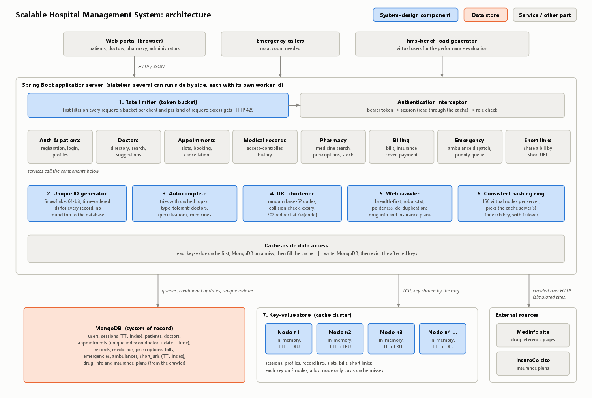

Blue boxes are the seven system-design components, orange is the database, grey is ordinary application code.

### 3.2 A request, end to end

Booking an appointment touches most of the system:

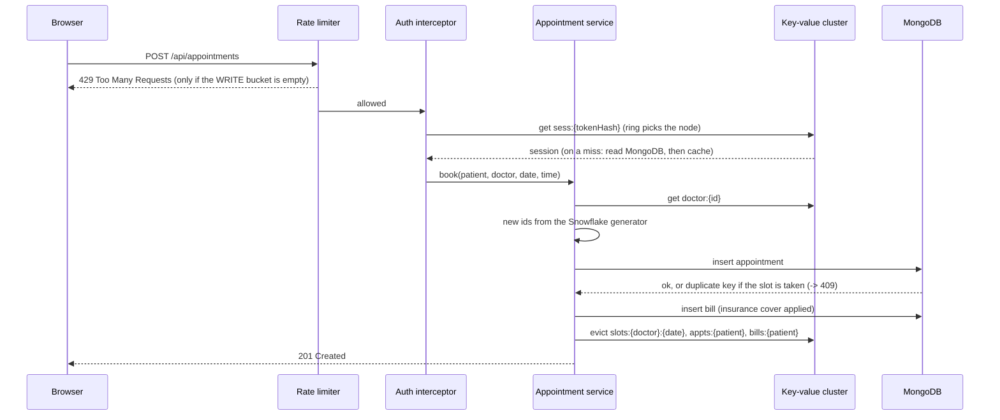

### 3.3 Data model

MongoDB is the single source of truth. Collections and the indexes that matter:

| Collection | Key fields | Indexes |
|---|---|---|
| `users` | email, BCrypt password hash, role | unique on `email` |
| `sessions` | SHA-256 of the token, user, role, expiry | TTL on `expiresAt` (MongoDB deletes expired sessions) |
| `patients` | profile, insurance plan | `email` |
| `doctors` | specialization, fee, rating, working days and hours, booking count | — |
| `appointments` | patient, doctor, date, time, status | **unique on (doctorId, date, time) where status = BOOKED**; (patientId, _id) |
| `records` | patient, author, type, text | (patientId, _id) |
| `medicines` | name, price, stock | — |
| `prescriptions` | patient, doctor, items, status | (patientId, _id); `status` |
| `bills` | patient, lines, insurance share, status | (patientId, _id) |
| `emergencies`, `ambulances` | severity, status, assigned ambulance | (status, severity); `status` |
| `short_urls` | code, target, expiry | TTL on `expiresAt` |
| `drug_info`, `insurance_plans` | crawled content, source URL | — |

Money is stored as whole paise (integers), never floating point.

### 3.4 Correctness under concurrency (problem P6)

The application never does "check, then act" on shared state. Every contested change is a single conditional
operation that MongoDB applies atomically:

| Situation | Mechanism | Result for the loser of a race |
|---|---|---|
| Two patients book the same slot | Unique partial index on (doctor, date, time) for BOOKED appointments; the second insert fails | HTTP 409 "slot has just been taken" |
| Two registrations with one email | Unique index on `users.email` | HTTP 409 |
| Dispensing the last units of a medicine | `update … where stock >= quantity` decrementing the stock | HTTP 409 "not enough stock"; earlier items of that prescription are put back |
| A prescription dispensed twice | status moved ISSUED → DISPENSING by a conditional update | HTTP 409 |
| A bill paid twice | status moved UNPAID → PAID by a conditional update | the already-paid bill is returned unchanged |
| Two emergencies claim one ambulance | status moved FREE → BUSY by a conditional update | the next-nearest ambulance is tried |

This is what lets the application servers stay stateless: no in-process locks hold correctness together, so
any number of servers can run side by side.

### 3.5 Caching rules

Cache-aside throughout: read the cache, on a miss read MongoDB and store the result with a time-to-live; on a
write, update MongoDB first and then evict the affected keys. A cache node can therefore be lost at any time
without losing data, only speed. Time-to-live values bound how long anything stale could survive if an
eviction were ever missed (sessions 10 min, profiles 10 min, record lists 5 min, lists of appointments and
bills 2 min, slot availability 1 min).

### 3.6 Security and privacy

- Passwords are stored as BCrypt hashes. A login returns a random 256-bit token; only its SHA-256 is stored.
- Role checks are declared on each endpoint (`@RequireAuth`). A patient can read only their own profile,
  records, prescriptions and bills; the pharmacy cannot read clinical records.
- The public emergency status shows no caller name or phone number.
- All input is validated; errors never expose internals. The web page escapes everything it displays.
- The rate limiter takes the client address from `X-Forwarded-For` only when the application is explicitly
  told it is behind a trusted proxy.
- Seed data, the crawled sites and all benchmark data are generated. Drug names are assembled from invented
  syllables and carry placeholder text, not medical information.

---

## 4. Working prototype

The prototype is one Spring Boot application with a web portal, started with a single command
(`run.bat`, see the [README](../README.md)). The portal adapts to who is signed in: each role sees only its
own pages in the side navigation.

| Who | Pages | What they demonstrate |
|---|---|---|
| **Anyone, no account** | Sign in / create account, Request ambulance | A full-screen sign-in page; the emergency request and its status. Nothing else is reachable without signing in |
| **Patient** | Overview, Find a doctor, Appointments, Records & prescriptions, Bills & insurance, Medicines | Doctor and medicine search with suggestions as you type (the response time of each suggestion request is shown); booking dialog with a 14-day date strip and morning/afternoon slots; cancelling with confirmation; paying a bill; sharing it as a short link; choosing an insurance plan and seeing its cover |
| **Doctor** | My schedule, Patient records, Emergency board, Medicines | The day's patients; a patient's history; adding a record; writing a prescription with medicine suggestions; resolving emergencies |
| **Pharmacist** | Dispensing, Medicines | Prescriptions waiting at the counter; dispensing (stock and bill in one step) |
| **Administrator** | System, Manage doctors, Dispensing, Emergency board | One tile per component with live figures; the cache cluster as a ring chart with stop / restart / add-a-server; live charts of requests per second and cache hit ratio; rate-limit counters and a 30-login test; switches to turn the cache and rate limiter off; crawler statistics; adding a doctor |

Search suggestions can be chosen with the arrow keys, dialogs and charts work from the keyboard, and the
interface uses a white-and-orange theme (with an optional dark mode) and has a phone layout.

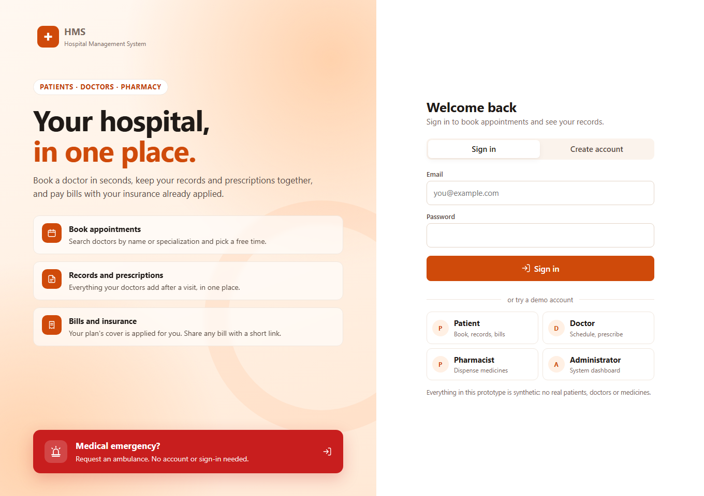

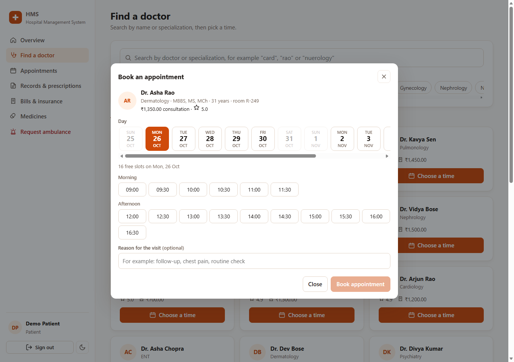 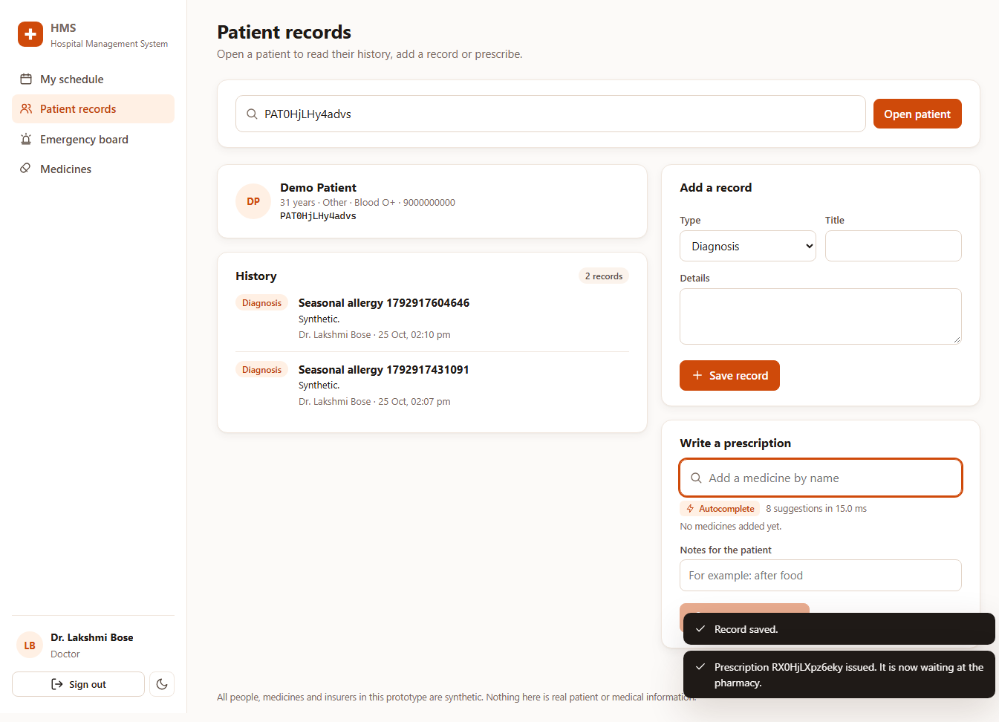

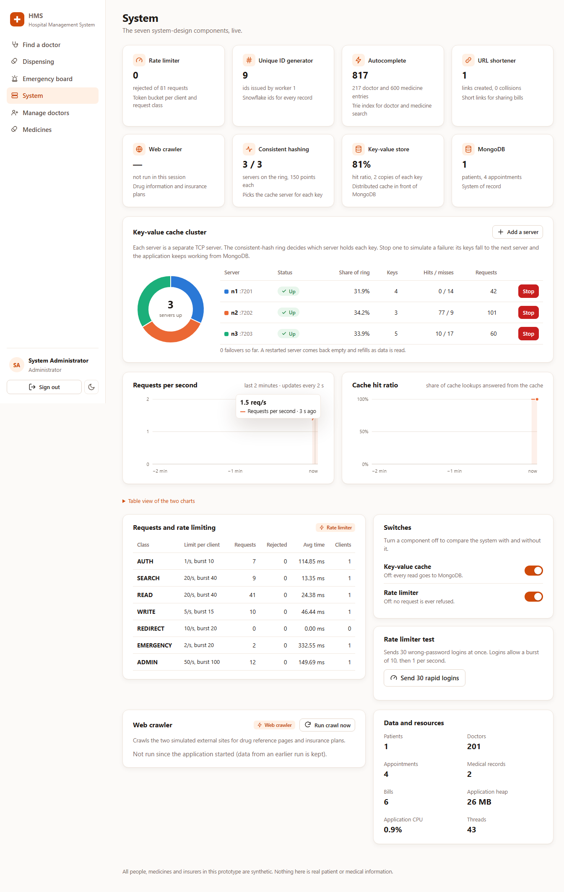

`java -jar hms-bench/target/hms-bench.jar demo` runs every workflow through the HTTP API and verifies each
outcome. Its output on the test machine:

```
 1. Patient registration               new patient PAT0HKbliVihX6 (Snowflake ID) for demo-mv2a4ved@synthetic.test
 2. Authentication                     duplicate email -> 409, wrong password -> 401, correct login -> session token
 3. Doctor autocomplete                'card' -> Cardiology (13 doctors); typo 'cardoilogy' -> Cardiology
 4. Doctor search                      'Bose' -> 4 doctor(s), including Dr. Lakshmi Bose
 5. Appointment booking                APT0HKblm8obgH with Dr. Lakshmi Bose on 2026-10-12 at 09:00
 6. Double-booking prevented           second request for the same slot -> 409 (unique index in MongoDB)
 7. Patient record access              doctor adds a record; the patient reads it; another patient -> 403
 8. Medicine autocomplete + prescription 'zyv' -> Zyvaformin; prescription RX0HKblnjJPoe (crawled drug information attached)
 9. Pharmacy dispensing                stock 302 -> 296, pharmacy bill Rs 4110.00; second dispense -> 409
10. Billing with insurance             Sunridge Care Cover Family covers 95%: Rs 350.00 -> payable Rs 17.50
11. Bill payment                       3 bills; BIL0HKblm8obgG paid by UPI; a repeated payment request changes nothing
12. URL shortener                      http://localhost:8090/s/J3Uwt9tM -> 302 /#/bills/BIL0HKblm8obgG
13. Emergency request (no login)       EMR0HKblpW0yXo -> DISPATCHED, Ambulance 06, ETA 3 min
14. Consistent-hash cache cluster      n1 32% (6 keys)  n2 34% (8 keys)  n3 34% (8 keys)
15. Cache and ID generator             cache hit ratio 62%, 12 IDs issued by worker 1
16. Rate limiter                       25 rapid login guesses: 5 reached the password check, 20 rejected with 429; an emergency request sent right after was still accepted
All 16 workflow steps passed.
```

The components also have 22 unit tests (`mvn test`), including key-value fail-over over real sockets and a
complete crawl of the simulated sites with exact expected counts of retries, duplicates and blocked pages.
Two further scripts in [`scripts/`](../scripts) check 33 business rules through the API (including twelve
simultaneous bookings of one slot, of which exactly one may succeed) and drive the web portal through every
role in a browser (49 checks).

---

## 5. Performance evaluation

Every number in this section comes from `results/*.json`, produced by `hms-bench`. The complete tables and
all 18 graphs are in [RESULTS.md](RESULTS.md), which is generated from the same files.

### 5.1 Method

**Test machine.** One laptop: Intel Core Ultra 7 155U (14 logical cores), 15.5 GB RAM, Windows 11,
Java 17.0.16, MongoDB 8.2. The load generator, the application, the cache nodes and MongoDB all ran on it,
so they competed for the same CPU. **The laptop was on battery power (Balanced power plan) when checked
straight after these runs**, and Windows throttles the processor on battery; the same code measured roughly 1.5 to 3 times faster in an earlier run
on the same machine. Absolute figures should therefore be read as conservative. Every comparison in this
section is between two things measured in the same run under the same conditions, so the comparisons hold.

**Workload.** Each virtual user is a thread acting as one logged-in patient with its own client address. It
picks an operation at random according to fixed weights, performs it, pauses 100 to 300 ms ("think time"),
and repeats. The mix is 85% reads and searches and 15% writes:

| Operation | Share | | Operation | Share |
|---|---|---|---|---|
| Doctor suggestions | 21% | | Book appointment | 6% |
| My records | 12% | | My bills | 6% |
| My appointments | 10% | | Medicine detail | 4% |
| Doctor search | 8% | | Pay bill | 3% |
| View slots | 8% | | Share bill + follow short link | 2% |
| My profile | 8% | | Emergency request | 2% |
| Medicine suggestions | 8% | | Login 1%, register 1% | 2% |

The database held 100,001 patients, 200,000 records, 100,000 past appointments and 200 doctors when the load
levels were run. Each level ran for 6 s of warm-up followed by 25 s of measurement.

**Metrics.** Average, median, 95th and 99th percentile response time measured at the client; throughput;
success, error and rate-limited fractions; the application's CPU use, heap and thread count read from the JVM;
cache hit ratio; and component-specific metrics. A booking refused with HTTP 409 because the slot was taken
counts as a success (it is the correct answer); 429 responses are counted separately; anything else is an error.

### 5.2 Three load levels and a stress level

| Level | Users | Throughput (req/s) | Avg (ms) | Median (ms) | p95 (ms) | p99 (ms) | Errors | Rate-limited | App CPU (cores of 14) | Heap max (MB) | Threads |
|---|---|---|---|---|---|---|---|---|---|---|---|
| Low | 25 | 123 | 6.1 | 1.9 | 8.6 | 152 | 0% | 0% | 0.9 | 132 | 82 |
| Medium | 100 | 495 | 5.0 | 1.5 | 6.5 | 147 | 0% | 0% | 2.4 | 127 | 82 |
| High | 400 | 1,832 | 16.0 | 1.5 | 76 | 309 | 0% | 0% | 8.1 | 129 | 229 |
| Stress | 1,000 | 2,042 | 266 | 197 | 700 | 1,273 | 0% | 0% | 8.4 | 159 | 329 |

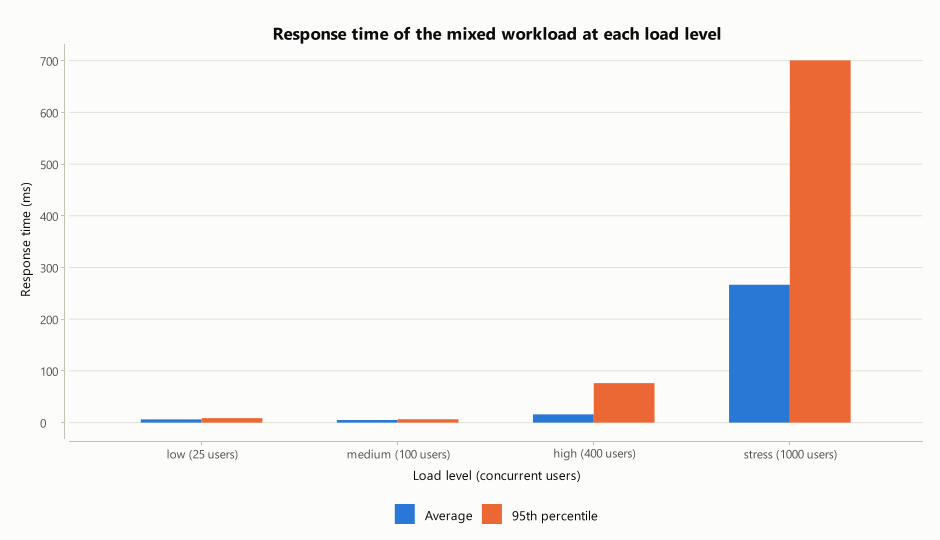
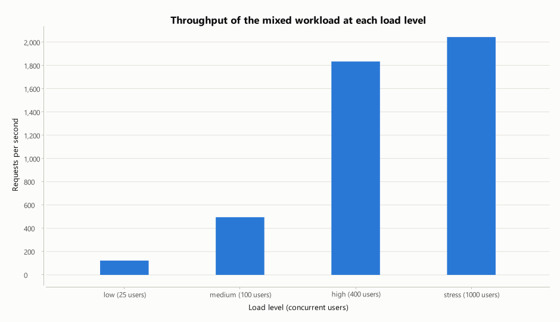

What this shows:

- **Low to medium is linear.** Four times the users gives four times the throughput (123 to 495 req/s) at the
  same response time. Half of all requests finish in under 2 ms.
- **High is near the limit of this one machine.** Throughput still scales (1,832 req/s, 92% of the 2,000 the
  users could generate), the median is unchanged at 1.5 ms, but the 95th percentile rises to 76 ms. The
  application alone is using 8 cores, with the load generator and MongoDB sharing the rest.
- **Stress is past the limit.** 2.5 times the users add only 11% more throughput and response time rises to
  hundreds of milliseconds. Nothing fails, though: the error rate stays at zero and no request is lost. The
  system degrades by getting slower, and the capacity of this single-machine deployment is about 2,000 req/s.
- **The 99th percentile is password hashing, not the system.** Login and registration each compute a BCrypt
  hash, which takes about 150 ms of CPU by design (that cost is what makes stolen hashes hard to crack). They
  are 2% of requests but, at the high level, 36 of them per second consume about 5.5 of the 8 cores the
  application is using. This is the first bottleneck. Everything else is fast: at the medium level a doctor
  suggestion averages 1.2 ms, reading records 1.4 ms and a complete booking (appointment, bill, cache
  evictions, ranking update) 5.7 ms.
- **The rate limiter never touched a normal user** (0% rate-limited at every level): its limits sit well above
  what a person does.
- Memory is flat (heap under 160 MB) because the application holds no per-user state.

Response time per operation at each level is in RESULTS.md, section 1.

### 5.3 Scalability scenario: growing the number of patients

Sixteen clients read random patients' records with no pause, at three database sizes. This is the brief's
"increasing the number of patients and appointments" scenario.

| Patients | Records | MongoDB only: avg / p95 (ms) | req/s | With cache: avg / p95 (ms) | req/s | Lookup by email p95 (ms) | Doctor suggestion p95 (ms) |
|---|---|---|---|---|---|---|---|
| 1,001 | 2,000 | 3.0 / 5.5 | 5,248 | 1.1 / 1.8 | 15,151 | 4.0 | 1.2 |
| 10,001 | 20,000 | 3.1 / 5.6 | 5,195 | 0.9 / 1.4 | 17,771 | 4.3 | 1.2 |
| 100,001 | 200,000 | 3.0 / 6.3 | 5,281 | 1.0 / 1.6 | 16,518 | 4.9 | 1.1 |

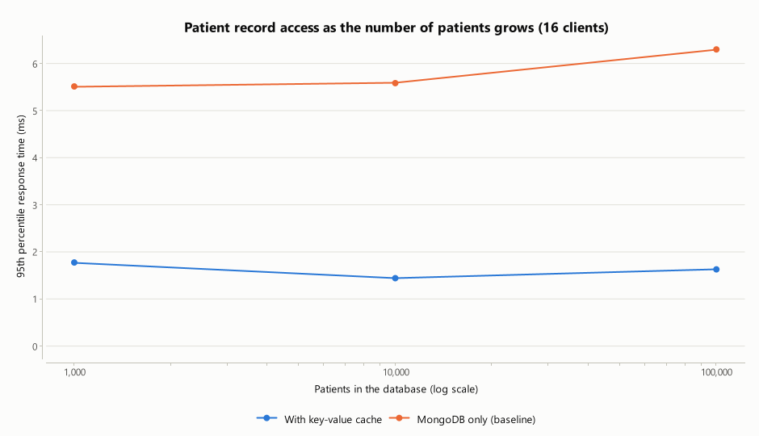

A hundred times more data makes no measurable difference to the average and adds under 1 ms at the 95th
percentile. The reason is in the design: every query is by primary key or by an indexed field, so the cost of
a lookup depends on the depth of an index, not on the number of patients; and suggestions come from the
in-memory trie, which does not look at the database at all. The cache makes the same read three times faster
and lets the same machine serve three times as many of them.

### 5.4 Comparisons with a baseline

**Key-value cache against MongoDB only** (same workload, 100 users, cache switched off at run time):

| Operation | With cache: avg (ms) | MongoDB only: avg (ms) |
|---|---|---|
| My records | 1.7 | 3.2 |
| My profile | 1.6 | 2.6 |
| My appointments | 3.1 | 4.0 |
| My bills | 3.7 | 4.1 |
| Doctor slots | 3.1 | 3.7 |
| Median of all requests | 1.8 | 2.9 |

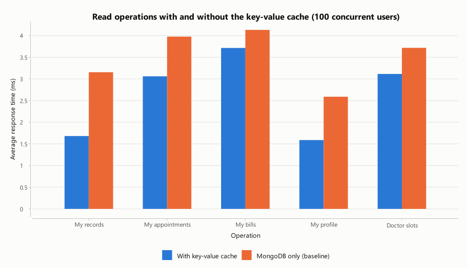

The cache hit ratio during the run was 91%. Every operation gains, because every request's session check
becomes a cache read; operations whose data is also cached gain twice. One case goes the other way and is
worth stating: following a short link exactly once is slower with the cache (2.7 ms against 1.9 ms), because a
first read is always a miss and pays for the cache round trips on top of the database read. When links are
followed repeatedly the cache wins (1.0 ms and 7,926 redirects/s against 1.6 ms and 5,101/s with 8 clients).
A cache helps data that is read more than once.

**Doctor search: autocomplete index against a database query** (16 clients, no pause):

| Doctors | Index: avg / p95 (ms) | req/s | MongoDB regex query: avg / p95 (ms) | req/s |
|---|---|---|---|---|
| 200 | 1.1 / 1.9 | 14,320 | 5.5 / 10.4 | 2,909 |
| 5,200 | 1.1 / 1.8 | 14,535 | 53 / 76 | 304 |
| 25,200 | 1.3 / 2.4 | 12,454 | 238 / 310 | 70 |

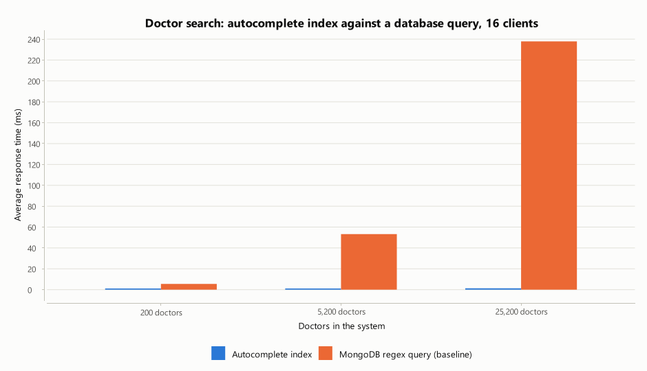

The database query has to examine every doctor on every keystroke, so its cost grows in step with the
directory: 43 times slower for 126 times more doctors. The index is unaffected. At 25,200 doctors it is 185
times faster and serves 178 times more searches per second.

**Rate limiter on and off while one client floods the API.** One hundred ordinary users run the normal
workload while a single client sends the expensive database search from 64 connections with no pause.

| | Ordinary users: avg (ms) | p95 (ms) | p99 (ms) | req/s | Flooding client: sent (req/s) | served (req/s) | rejected |
|---|---|---|---|---|---|---|---|
| Rate limiter off (baseline) | 39.7 | 217 | 451 | 421 | 66 | 66 | 0% |
| Rate limiter on | 21.6 | 97 | 367 | 452 | 11,552 | 23 | 99.8% |

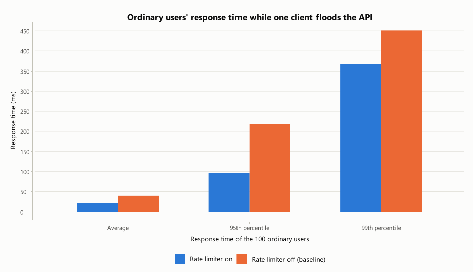

With the limiter off, the flooding client occupies MongoDB with 64 simultaneous collection scans and ordinary
users' 95th percentile is 217 ms (it was 6.5 ms without the attacker). With it on, 99.8% of the attacker's
requests are turned away before they reach any service code, and ordinary users' 95th percentile is more than
halved. It does not return to 6.5 ms, for two honest reasons. First, the 20 searches a second the attacker is
still allowed are, for this deliberately expensive endpoint, enough to keep MongoDB busy: a limit counted in
requests does not account for how much each request costs. Second, turning away 11,500 requests a second is
cheap but not free, and here it competes for the same CPU as everything else. The lessons are to charge
expensive endpoints more than one token, and to reject abusive traffic before it reaches the application
servers (at a load balancer) when possible.

### 5.5 Failure and scale-out scenario

Two hundred users run the normal workload at a steady 1,000 req/s for 45 seconds. At 12 s cache server n2 is
killed; at 23 s it is restarted, empty; at 34 s a fourth server is added. The run is done twice: with every
cache key stored on two servers (the default) and on one.

| Copies of each key | Requests | Errors | p95 overall (ms) | Worst one-second p95 (ms) | Cache hit ratio: before | after kill | after restart | after adding a server |
|---|---|---|---|---|---|---|---|---|
| 2 (default) | 44,734 | 0 | 5.3 | 6.5 | 90% | 89% | 90% | 85% |
| 1 | 44,355 | 0 | 5.5 | 7.2 | 90% | 78% | 82% | 81% |

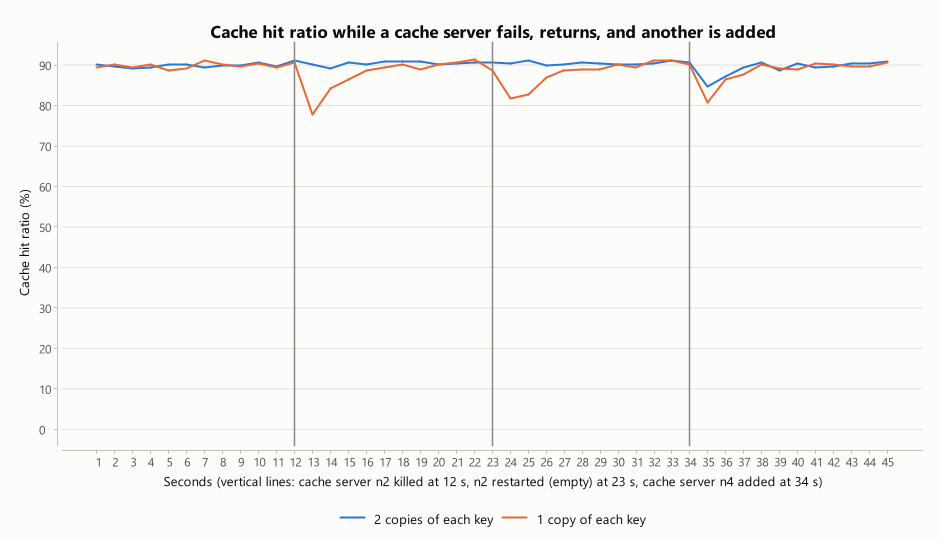
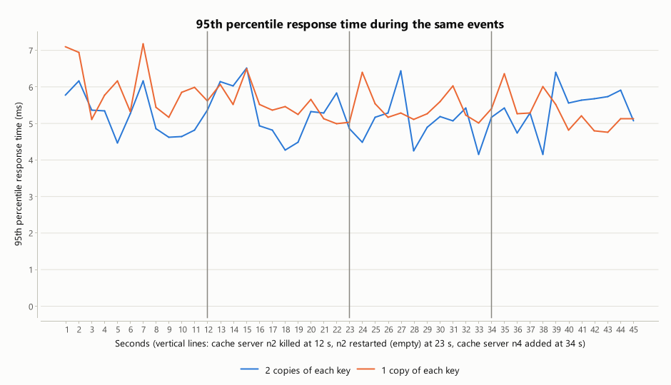

- **No request failed in either run**, through a server crash, its return and a topology change. The
  cluster client notices the failed server (in 43 to 96 ms in the component test), takes it off the ring, and
  reads fall through to the next server or to MongoDB.
- **With one copy per key the damage is limited to the lost server's share.** The hit ratio falls from 90% to
  78%, not to zero, and is back to normal within about three seconds as the missing entries are reloaded. This
  is consistent hashing doing its job: only the keys of the lost server are affected.
- **With two copies per key a server failure is invisible**: the other copy answers. Only adding a server
  shows (85% for a second or two), because the new server is first in line for a quarter of the keys and has
  to be filled.
- **Users notice nothing either way.** The 95th percentile stays between 4 and 7 ms throughout, because a
  cache miss costs one extra database read, not a failure.

The same experiment at component level, with 40,000 cached keys on four servers and with `hash mod N` as
the baseline, gives the exact fractions:

| Event | Consistent hashing, 1 copy | Consistent hashing, 2 copies | hash mod N, 1 copy (baseline) |
|---|---|---|---|
| One of 4 servers fails: lookups still served from cache | 76.7% | 100% | 24.8% |
| A 5th server is added: lookups still served from cache | 77.8% | 100% | 19.9% |

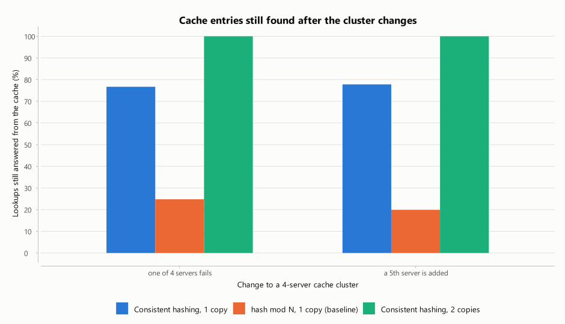

With modulo placement, losing one server of four invalidates three quarters of the cache at once, and the
database receives that load at the worst possible moment. With the ring, three quarters survive.

**The database tier, sharded.** The experiments above scale out the cache. The database itself was also run
on a MongoDB sharded cluster: a router, a config server and two shards, then a third. Patients, records,
bills and prescriptions are placed by a hash of the patient id, appointments by a hash of the doctor id. The
double-booking index must start with the shard key, and that choice satisfies it. The full set-up and results
are in [SHARDING.md](SHARDING.md). In brief:

- All workflow and business-rule checks pass unchanged.
- 100,000 patients split 49.9% / 50.1%, and a patient's own queries reach one shard only.
- A third shard was added under load, and 27% of patients moved to it in 64 to 85 s with 0 errors in 175,019
  requests.
- With one shard stopped, only patients whose data was on it lost access, while doctor search and emergencies
  were unaffected.

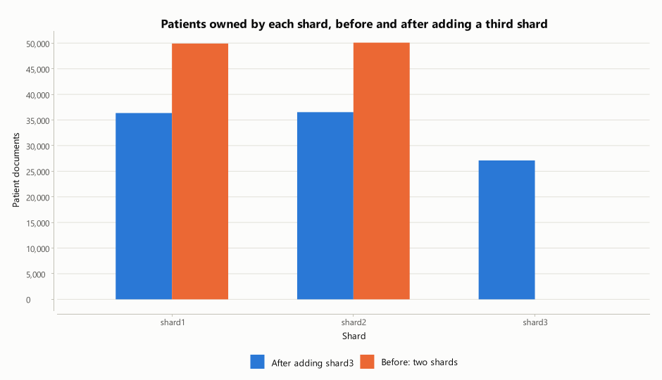

### 5.6 Component-specific metrics

**Unique ID generator: generation rate and collisions**

| Generator | IDs per second | Collisions | Size | Time-ordered | Needs a shared server |
|---|---|---|---|---|---|
| Snowflake, 1 thread | 3.87 million | 0 in 2,000,000 | 64 bits | yes | no |
| Snowflake, 8 threads sharing one generator | 3.73 million | 0 in 2,000,000 | 64 bits | yes | no |
| Snowflake, 4 servers with their own worker ids | 13.8 million | 0 in 2,000,000 | 64 bits | yes | no |
| Baseline: random UUID | 0.58 million | 0 in 500,000 | 128 bits | no | no |
| Baseline: random 32-bit number | 35 million | **479 in 2,000,000** | 32 bits | no | no |
| Baseline: one shared counter | 48 million | 0 | 64 bits | yes | **yes** |

One generator runs at 95% of the layout's ceiling of 4,096 IDs per millisecond, and four servers give close to
four times that with no coordination and no collisions. Short random numbers collide, as the birthday paradox
predicts. A shared counter is fastest in one process but cannot be used by several servers without a network
round trip per ID. For scale: the hospital workload above created a few hundred IDs a second at its busiest.

**Rate limiter: rejection rate**

| Client's rate (multiple of its limit) | Least any limiter could reject | Token bucket | Fixed window | Sliding window log |
|---|---|---|---|---|
| 0.5x | 0% | 0.0% | 0.5% | 1.9% |
| 0.8x | 0% | 0.4% | 5.3% | 12.0% |
| 1.0x | 0% | 4.9% | 12.4% | 21.2% |
| 1.5x | 33.1% | 33.0% | 34.0% | 40.8% |
| 2x | 49.8% | 49.8% | 49.9% | 53.7% |
| 10x | 90.0% | 90.0% | 90.0% | 90.1% |

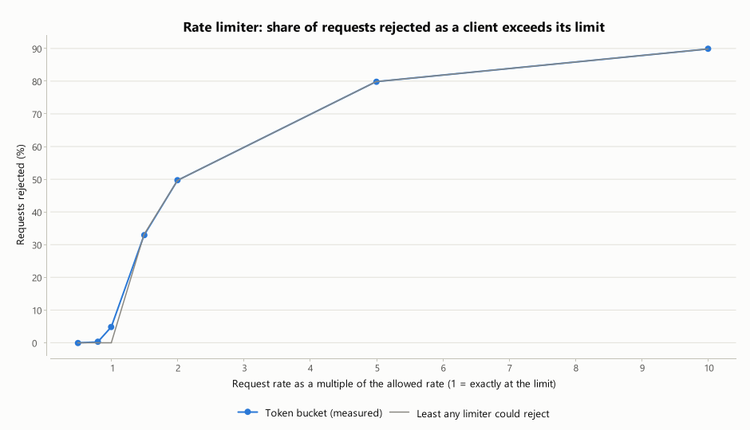

(One simulated hour of randomly spaced requests against a limit of 10 per second.) The token bucket is the
fairest of the three to a client that stays within its limit: random bunching makes the window-based limiters
reject 5% to 12% of a client running at 80% of its allowance, while the token bucket's burst allowance absorbs
it (0.4%). Above the limit all three converge on the unavoidable minimum. In a 20 ms burst straddling a
window boundary the fixed window admits **20** requests against a limit of 10; the token bucket and the
sliding log admit 10. A decision costs about 165 ns, and tracking a client takes about 139 bytes (220 for the
sliding log, which stores every timestamp). End to end, 99.8% of a flooding client's requests were rejected
(5.4), and 20 or 21 of 25 rapid login guesses in the workflow demo.

**Consistent hashing: load distribution and keys moved**

| Virtual nodes per server | 1 | 10 | 50 | 100 | **150 (used)** | 300 | 500 |
|---|---|---|---|---|---|---|---|
| Std. deviation of load across 5 servers (% of mean) | 79.7 | 25.0 | 11.5 | 8.2 | **8.1** | 6.1 | 4.2 |
| Largest share seen (ideal 20%) | 74.0 | 39.1 | 25.5 | 25.4 | **24.1** | 23.7 | 22.2 |

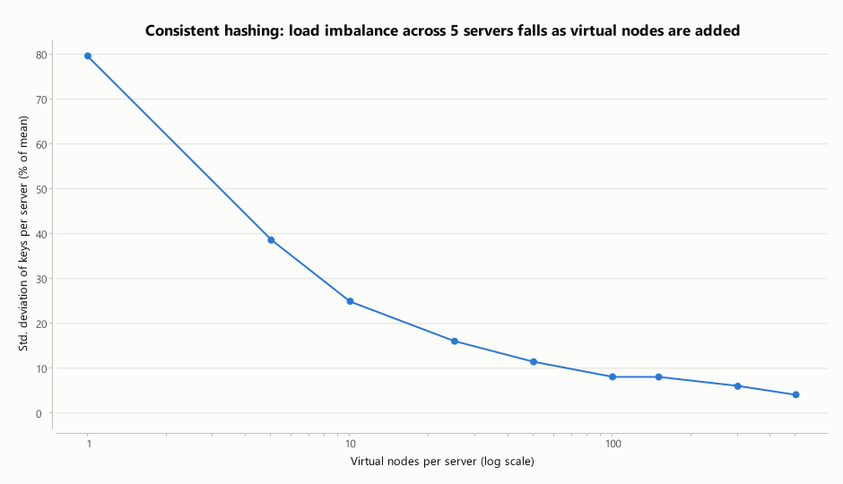

Averaged over 30 different sets of server names. With one point per server the busiest server can end up
with three quarters of the keys; with 150 virtual nodes the spread is 8%. In the running application the three
cache servers owned 32%, 34% and 34% of the ring.

| Membership change | Least possible | Consistent hashing | hash mod N (baseline) |
|---|---|---|---|
| 4 to 5 servers | 20% | 22.1% | 80.0% |
| 10 to 11 servers | 9.1% | 8.3% | 90.8% |
| 3 to 2 servers | 33.3% | 33.0% | 66.7% |

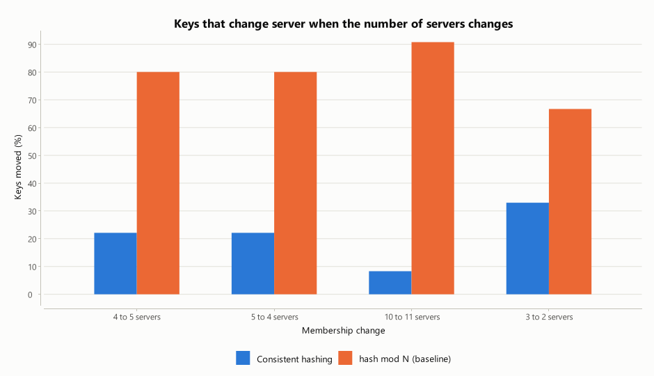

Consistent hashing moves close to the theoretical minimum; modulo moves nearly everything, and gets worse as
the cluster grows. Routing a key costs about 0.6 µs, most of it the hash.

**Key-value store: lookup latency**

| Keys stored | Key-value node: get avg / p95 (µs) | Unindexed list scan, baseline: avg (µs) | MongoDB find by `_id`: avg / p95 (µs) |
|---|---|---|---|
| 10,000 | 69 / 101 | 86 | 403 / 640 |
| 100,000 | 80 / 137 | 818 | 268 / 479 |
| 1,000,000 | 65 / 86 | 11,464 | 396 / 653 |

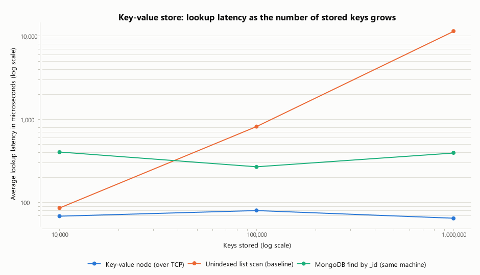

Lookup time through the network is flat from ten thousand to a million keys, as a hash index should be; a
scan grows in proportion to the data. A node served about 87,000 lookups a second to 16 clients. Almost all of
the 65 to 80 µs is the network round trip: the storage engine itself answers in under 1 µs. MongoDB's fastest
lookup on the same machine takes 3 to 6 times as long, which is the saving the cache passes on in 5.4.

**Autocomplete: suggestion response time and accuracy**

| Dictionary entries | Trie: avg / p95 (µs) | Linear scan, baseline: avg (µs) | Speed-up | Trie with typo tolerance: avg / p99 (µs) | Index memory |
|---|---|---|---|---|---|
| 1,000 | 0.9 / 1.3 | 44 | 49x | 8.6 / 47 | 1.3 MB |
| 10,000 | 0.9 / 1.7 | 550 | 604x | 1.2 / 13 | 9.2 MB |
| 100,000 | 1.3 / 1.4 | 7,519 | 5,967x | 1.2 / 54 | 88 MB |

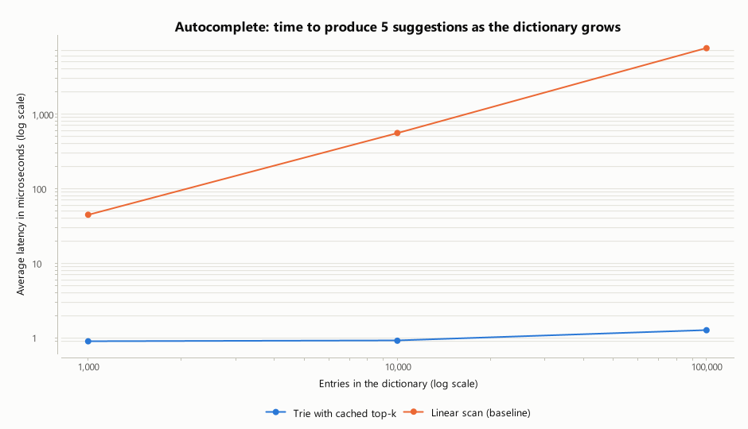

The trie answers in about a microsecond whatever the size; the scan takes 7.5 ms at 100,000 entries, which is
too slow to run on every keystroke of every user. Through the full application a suggestion took 1.0 ms on
average. The typo-tolerant search only runs when a prefix has fewer than five exact matches, so it costs most
on a small dictionary. The price of the trie is memory: about 880 bytes per entry.

Accuracy, on 100,000 entries with popularity following a 1/rank distribution:

| What the user typed | Wanted entry is in the 5 suggestions: ranked trie | Alphabetical matches (baseline) |
|---|---|---|
| 2 letters | 38.8% | 0.0% |
| 3 letters | 48.1% | 0.1% |
| 4 letters | 66.9% | 0.6% |
| 5 letters | 73.2% | 7.1% |
| 6 letters with one typo | 72.0% (2.7% without typo tolerance) | 0.5% |

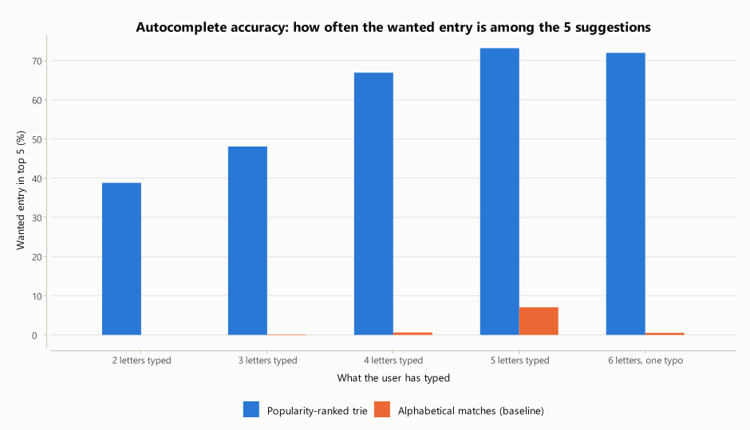

The trie's five suggestions were exactly the five highest-ranked matches in 100% of 500 checks against a
brute-force search. Ranking is what makes suggestions useful: after three letters the popularity-ranked trie
already shows the wanted entry nearly half the time, while the first five matches in alphabetical order almost
never contain it. A single typo would otherwise defeat prefix matching completely.

**URL shortener: redirection latency and collisions**

| Code length | Possible codes | Collisions while creating 500,000 links |
|---|---|---|
| 4 | 1.5 × 10^7 | 8,540 (1.7%) |
| 5 | 9.2 × 10^8 | 118 |
| 6 | 5.7 × 10^10 | 2 |
| **8 (used)** | 2.2 × 10^14 | 0 |

Redirection through the full application: **1.0 ms average, 1.8 ms at the 95th percentile, 7,926 redirects a
second** with 8 clients when the code is in the cache; 1.6 ms and 5,101 a second from MongoDB. Collisions are
detected and retried, so even 4-character codes work, but 8 characters make them a non-event and make guessing
a valid code impractical (and guessing is rate-limited).

**Web crawler: crawling throughput**

| Worker threads | 1 (sequential baseline) | 2 | 4 | 8 | 16 | 32 | 16, with a 25 ms politeness delay per site |
|---|---|---|---|---|---|---|---|
| Pages per second | 27 | 55 | 108 | 206 | 363 | 592 | 42 |

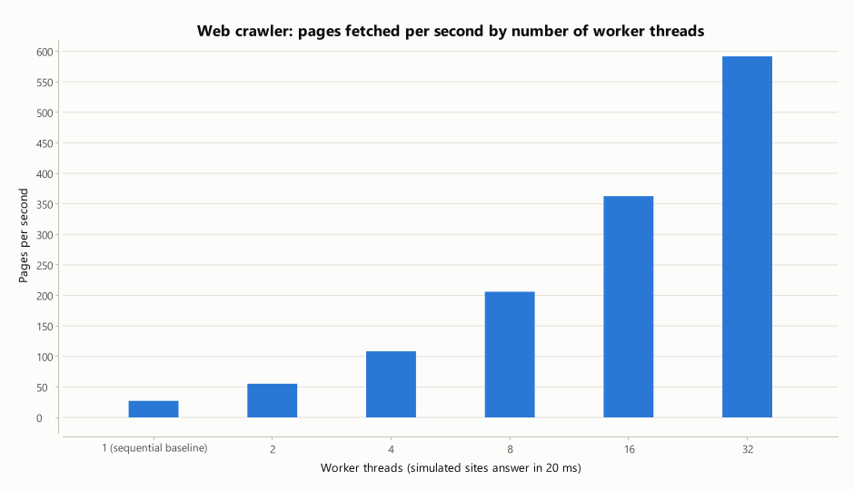

Each simulated site waits 20 to 31 ms before answering, so one worker cannot exceed about 30 to 50 pages a
second; throughput then scales almost linearly with workers (21.7 times at 32). Every run fetched the same 403
pages and extracted all 300 drug pages and all 30 insurance plans. The crawler skipped 1,403 links to URLs it
had already seen and 38 pages whose content it had already processed, retried the 15 pages that failed once,
gave up on the 8 broken links, did not request the 3 URLs disallowed by `robots.txt` (the sites recorded zero
requests to disallowed paths) and never entered the endless calendar. With a politeness delay the rate is set
by the delay, not by the number of workers, which is the point of it.

### 5.7 Summary against the brief's metrics

| Metric asked for | Result |
|---|---|
| Average and 95th percentile response time | 5.0 ms and 6.5 ms at 100 users; 16 ms and 76 ms at 400 users |
| Throughput | 495 req/s at 100 users, 1,832 at 400; capacity of the one-machine setup about 2,000 req/s |
| Success / error rate | 100% / 0% at all four levels and through the server failure |
| Resource usage | 2.4 CPU cores and 127 MB heap at 100 users; 8.1 cores and 129 MB at 400 |
| Rate limiter: rejection rate | 99.8% of a flooding client; 0% of normal users; within 0.1 points of the minimum when over the limit |
| Consistent hashing: load distribution | 8% standard deviation across servers; 22% of keys moved on 4 to 5 servers against 80% for modulo |
| Key-value store: lookup latency | 65 to 80 µs average, flat from 10,000 to 1,000,000 keys; 3 to 6 times faster than MongoDB by `_id` |
| ID generator: rate and collisions | 3.9 million per second per server; 0 collisions in 6,000,000 |
| URL shortener: redirection latency | 1.0 ms average, 1.8 ms p95 |
| Web crawler: throughput | 27 pages/s with one worker, 592 with 32 |
| Autocomplete: response time and accuracy | about 1 µs in the index, 1.0 ms end to end; wanted entry in the top 5 for 48% of 3-letter prefixes, 72% with a typo |
| Three workload levels | low, medium, high, plus a stress level |
| Baseline comparisons | cache, search, rate limiter, hashing, ID generation, key-value lookup, autocomplete, crawler |
| Scalability or failure scenario | patients grown from 1,000 to 100,000; a cache server killed, restarted and added under load; a MongoDB shard added under load and a shard stopped ([SHARDING.md](SHARDING.md)) |

---

## 6. Limitations and what would come next

- **One machine, on battery.** Client, application, cache and database shared one throttled laptop CPU, so the
  absolute capacity figure says more about the laptop than about the design. The next step is to run the
  application, MongoDB and the load generator on separate machines, and to run two or three application
  servers behind a load balancer; the design is ready for that (stateless servers, a worker id per server).
- **Password hashing is the first bottleneck.** It is meant to be expensive, but it should not be able to
  starve other requests. A small dedicated thread pool for hashing would cap its share of the CPU.
- **Rate limits count requests, not cost.** As 5.4 showed, an expensive endpoint needs a higher price per
  request. Limits are also held in each application server's memory; with several servers they should be
  stored in the key-value cluster so a client cannot multiply its allowance by spreading requests.
- **The cache nodes run inside the application process by default.** They are separate TCP servers and can
  run as separate processes, but the measured failure was a stopped server, not a lost machine or a network
  partition. The client detects a failure by a failed request or a health check (connect timeout 200 ms).
- **The autocomplete index lives in each application server's memory** and is rebuilt from MongoDB at start-up.
  With several servers, a doctor added through one is not searchable on the others until they reload; a
  shared change feed or periodic refresh is needed. It also costs about 880 bytes per entry.
- **No multi-document transactions.** Correctness rests on single atomic operations (3.4). A crash between
  inserting an appointment and its bill would leave an appointment without a bill; a production system would
  use MongoDB transactions on a replica set, or a repair job.
- **The crawler ran against simulated sites.** Real sites need content-type handling, redirects across hosts,
  far larger frontiers held on disk, and re-crawl scheduling.
- **The database runs as one server by default.** It can run sharded (`run.bat sharded`, [SHARDING.md](SHARDING.md)),
  but in that test every shard was a single server on the same laptop. Production needs each shard to be a
  three-member replica set, on its own machine.
- **Demonstration shortcuts:** plain HTTP, demo accounts with published passwords, no audit log of record
  access. Each would have to change before real use.

## 7. Reproducing the results

```
run.bat build                  build and run the 22 unit tests
run.bat                        start the application (http://localhost:8088)
run.bat demo                   the 16-step workflow check, in a second window
run.bat bench all              every measurement and graph, about 15 minutes
run.bat sharded                the application on a local MongoDB sharded cluster (see SHARDING.md section 4)
```

`run.bat bench all --quick` does a short trial of everything in about 5 minutes. The benchmark starts its own
copy of the application on port 8095 with a scratch database (`hms_bench`), so it never touches the data of a
running instance. For numbers that reflect the hardware, run on mains power, close other applications, and
keep the project folder out of a folder that is being synchronised to the cloud.
