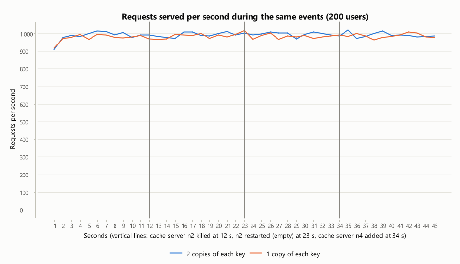
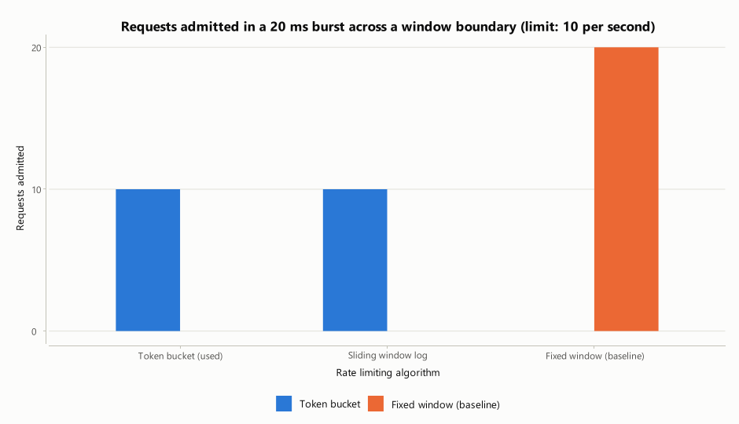

# Measured results

This file is generated by `hms-bench report` from the JSON files in `results/`. Do not edit it by hand:
re-run the benchmarks and regenerate it. The discussion of these numbers is in [REPORT.md](REPORT.md).

**Test machine:** Windows 11 10.0, 14 logical cores, 15.5 GB RAM, Eclipse Adoptium 17.0.16. Load generator, application, cache nodes and MongoDB all ran on this one machine.

## 1. End-to-end workload at increasing load

_Measured 2026-10-11T13:21:24+05:30._

Each virtual user is a logged-in patient who performs one operation, pauses 100-300 ms, and repeats.
The mix is 85% reads and searches and 15% writes (bookings, payments, link sharing, emergencies, logins, registrations).
Logins and registrations are slow on purpose: each one computes a BCrypt password hash. They are 2% of requests
but pull the average and the 99th percentile up, which is why the median is shown as well.

| Level | Users | Throughput (req/s) | Avg (ms) | Median (ms) | p95 (ms) | p99 (ms) | Success | Errors | Rate-limited | App CPU (cores) | Heap max (MB) | Threads | Cache hits |
| --- | --- | --- | --- | --- | --- | --- | --- | --- | --- | --- | --- | --- | --- |
| low | 25 | 123 | 6.15 | 1.89 | 8.58 | 152 | 100.00% | 0.00% | 0.00% | 0.87 | 132 | 82 | 86.80% |
| medium | 100 | 495 | 4.97 | 1.50 | 6.47 | 147 | 100.00% | 0.00% | 0.00% | 2.45 | 127 | 82 | 89.60% |
| high | 400 | 1,832 | 16.0 | 1.46 | 76.3 | 309 | 100.00% | 0.00% | 0.00% | 8.06 | 129 | 229 | 90.40% |
| stress | 1,000 | 2,042 | 266 | 197 | 700 | 1,273 | 100.00% | 0.00% | 0.00% | 8.44 | 159 | 329 | 91.10% |

### Response time by operation (ms)

| Operation | low avg | low p95 | medium avg | medium p95 | high avg | high p95 | stress avg | stress p95 |
| --- | --- | --- | --- | --- | --- | --- | --- | --- |
| suggest doctor | 1.53 | 2.57 | 1.16 | 1.83 | 2.21 | 6.28 | 183 | 401 |
| search doctor | 1.65 | 2.67 | 1.25 | 1.81 | 2.33 | 7.18 | 183 | 389 |
| view slots | 4.97 | 7.22 | 3.25 | 4.52 | 14.2 | 57.3 | 254 | 555 |
| book appointment | 7.70 | 10.6 | 5.71 | 7.38 | 48.2 | 203 | 529 | 993 |
| my appointments | 2.72 | 5.31 | 2.17 | 4.23 | 7.89 | 33.4 | 229 | 521 |
| my records | 1.66 | 2.57 | 1.37 | 2.22 | 2.30 | 6.37 | 183 | 393 |
| my profile | 1.74 | 2.64 | 1.35 | 2.04 | 2.17 | 5.81 | 184 | 394 |
| suggest medicine | 1.62 | 2.66 | 1.22 | 1.89 | 2.33 | 5.23 | 185 | 405 |
| medicine detail | 3.56 | 5.19 | 2.45 | 3.37 | 17.1 | 70.8 | 306 | 600 |
| my bills | 3.23 | 5.34 | 2.62 | 4.74 | 10.7 | 42.6 | 241 | 530 |
| pay bill | 5.69 | 7.26 | 4.66 | 6.09 | 33.4 | 142 | 413 | 751 |
| share bill | 4.34 | 5.99 | 3.47 | 4.48 | 29.9 | 130 | 409 | 753 |
| emergency | 9.25 | 12.1 | 7.71 | 9.59 | 76.6 | 307 | 720 | 1,247 |
| login | 151 | 160 | 147 | 172 | 259 | 455 | 1,233 | 2,200 |
| register | 153 | 163 | 145 | 172 | 291 | 512 | 1,320 | 2,215 |
| follow short link | 2.90 | 4.34 | 2.59 | 3.61 | 16.6 | 58.7 | 281 | 572 |

## 2. Scalability: growing the number of patients

Sixteen clients read random patients' records back to back, with the rate limiter off, at each data size.

| Patients | Records | Records, MongoDB only: avg (ms) | p95 (ms) | req/s | Records, with cache: avg (ms) | p95 (ms) | req/s | Lookup by email p95 (ms) | Doctor suggest p95 (ms) |
| --- | --- | --- | --- | --- | --- | --- | --- | --- | --- |
| 1,001 | 2,000 | 3.05 | 5.52 | 5,248 | 1.06 | 1.78 | 15,151 | 4.00 | 1.22 |
| 10,001 | 20,000 | 3.08 | 5.59 | 5,195 | 0.90 | 1.45 | 17,771 | 4.29 | 1.21 |
| 100,001 | 200,000 | 3.03 | 6.31 | 5,281 | 0.97 | 1.64 | 16,518 | 4.89 | 1.13 |

## 3. Comparisons with a baseline

### 3.1 Key-value cache on vs off

| Operation | Cache on: avg (ms) | p95 (ms) | MongoDB only: avg (ms) | p95 (ms) |
| --- | --- | --- | --- | --- |
| All operations | 5.54 | 6.44 | 6.28 | 7.31 |
| my records | 1.68 | 2.31 | 3.15 | 4.20 |
| my appointments | 3.06 | 5.33 | 3.98 | 5.15 |
| my bills | 3.71 | 5.71 | 4.13 | 5.36 |
| my profile | 1.59 | 2.27 | 2.59 | 3.66 |
| view slots | 3.11 | 4.68 | 3.72 | 4.85 |
| book appointment | 5.63 | 7.08 | 6.50 | 8.39 |

Application CPU: 2.29 cores with the cache, 2.49 without. Cache hit ratio during the run: 90.70%.

### 3.2 Doctor search: autocomplete index vs database query

| Doctors | Index search: avg (ms) | p95 (ms) | req/s | MongoDB regex: avg (ms) | p95 (ms) | req/s | Suggestions: avg (ms) | p95 (ms) |
| --- | --- | --- | --- | --- | --- | --- | --- | --- |
| 200 | 1.12 | 1.90 | 14,320 | 5.51 | 10.4 | 2,909 | 0.98 | 1.56 |
| 5,200 | 1.10 | 1.77 | 14,535 | 53.2 | 76.3 | 304 | 1.01 | 1.64 |
| 25,200 | 1.29 | 2.38 | 12,454 | 238 | 310 | 69.8 | 1.02 | 1.67 |

### 3.3 Rate limiter on vs off while one client floods the API

100 ordinary users run the normal workload while one client sends database-backed searches from 64 connections with no pause.

| Mode | Ordinary users: avg (ms) | p95 (ms) | p99 (ms) | req/s | errors | Flooder: sent (req/s) | served (req/s) | rejected | App CPU (cores) |
| --- | --- | --- | --- | --- | --- | --- | --- | --- | --- |
| Rate limiter off (baseline) | 39.7 | 217 | 451 | 421 | 0.00% | 66 | 66 | 0.00% | 2.00 |
| Rate limiter on | 21.6 | 97.0 | 367 | 452 | 0.00% | 11,552 | 23.3 | 99.80% | 3.91 |

### 3.4 URL shortener: redirect latency

| Mode | Redirect avg (ms) | p95 (ms) | p99 (ms) | Redirects/s (8 clients) |
| --- | --- | --- | --- | --- |
| Code looked up in key-value cache | 1.01 | 1.84 | 2.65 | 7,926 |
| Code looked up in MongoDB (baseline) | 1.57 | 1.99 | 4.34 | 5,101 |

## 4. Failure and scale-out scenario

_Measured 2026-10-11T13:27:47+05:30._

200 users run the normal workload throughout. Events: cache server n2 killed at second 12; n2 restarted (empty) at second 23; cache server n4 added at second 34.
The run is repeated with each cache key stored on two servers and on one.

| Copies of each key | Requests | Error rate | Avg (ms) | p95 overall (ms) | Worst one-second p95 (ms) | Slowest single request (ms) | Lowest one-second cache hit ratio |
| --- | --- | --- | --- | --- | --- | --- | --- |
| 2 | 44,734 | 0.00% | 3.97 | 5.29 | 6.52 | 181 | 84.80% |
| 1 | 44,355 | 0.00% | 5.15 | 5.52 | 7.20 | 220 | 77.80% |

### Second-by-second data

| Second | 2 copies: req | errors | p95 (ms) | cache hits | servers up | 1 copy: req | errors | p95 (ms) | cache hits | Event (happens as this second ends) |
| --- | --- | --- | --- | --- | --- | --- | --- | --- | --- | --- |
| 1 | 910 | 0 | 5.78 | 90.30% | 3 | 919 | 0 | 7.11 | 89.50% |  |
| 2 | 980 | 0 | 6.16 | 89.70% | 3 | 976 | 0 | 6.96 | 90.10% |  |
| 3 | 991 | 0 | 5.38 | 89.30% | 3 | 981 | 0 | 5.12 | 89.50% |  |
| 4 | 985 | 0 | 5.35 | 89.50% | 3 | 997 | 0 | 5.78 | 90.10% |  |
| 5 | 1,002 | 0 | 4.47 | 90.30% | 3 | 970 | 0 | 6.18 | 88.80% |  |
| 6 | 1,017 | 0 | 5.27 | 90.30% | 3 | 997 | 0 | 5.33 | 89.30% |  |
| 7 | 1,014 | 0 | 6.16 | 89.50% | 3 | 995 | 0 | 7.20 | 91.10% |  |
| 8 | 995 | 0 | 4.87 | 90.00% | 3 | 979 | 0 | 5.46 | 90.30% |  |
| 9 | 1,008 | 0 | 4.63 | 89.90% | 3 | 978 | 0 | 5.19 | 89.70% |  |
| 10 | 980 | 0 | 4.64 | 90.60% | 3 | 983 | 0 | 5.86 | 90.50% |  |
| 11 | 994 | 0 | 4.82 | 89.70% | 3 | 992 | 0 | 6.01 | 89.50% |  |
| 12 | 995 | 0 | 5.38 | 91.20% | 3 | 973 | 0 | 5.62 | 90.70% | **cache server n2 killed** |
| 13 | 987 | 0 | 6.16 | 90.30% | 2 | 969 | 0 | 6.07 | 77.80% |  |
| 14 | 979 | 0 | 6.03 | 89.30% | 2 | 973 | 0 | 5.52 | 84.40% |  |
| 15 | 976 | 0 | 6.52 | 90.80% | 2 | 997 | 0 | 6.51 | 86.40% |  |
| 16 | 1,010 | 0 | 4.94 | 90.10% | 2 | 995 | 0 | 5.53 | 88.80% |  |
| 17 | 1,010 | 0 | 4.82 | 91.00% | 2 | 992 | 0 | 5.37 | 89.40% |  |
| 18 | 990 | 0 | 4.28 | 91.00% | 2 | 1,001 | 0 | 5.48 | 90.20% |  |
| 19 | 989 | 0 | 4.49 | 91.00% | 2 | 976 | 0 | 5.25 | 89.10% |  |
| 20 | 1,001 | 0 | 5.34 | 90.10% | 2 | 994 | 0 | 5.66 | 90.20% |  |
| 21 | 1,013 | 0 | 5.29 | 90.40% | 2 | 982 | 0 | 5.13 | 90.70% |  |
| 22 | 994 | 0 | 5.84 | 90.60% | 2 | 997 | 0 | 5.01 | 91.50% |  |
| 23 | 1,004 | 0 | 4.86 | 90.70% | 2 | 1,018 | 0 | 5.05 | 88.80% | **n2 restarted (empty)** |
| 24 | 994 | 0 | 4.49 | 90.50% | 3 | 969 | 0 | 6.40 | 81.80% |  |
| 25 | 1,000 | 0 | 5.17 | 91.20% | 3 | 990 | 0 | 5.55 | 82.90% |  |
| 26 | 1,010 | 0 | 5.29 | 89.90% | 3 | 1,005 | 0 | 5.17 | 87.10% |  |
| 27 | 1,005 | 0 | 6.44 | 90.20% | 3 | 969 | 0 | 5.29 | 88.80% |  |
| 28 | 1,004 | 0 | 4.27 | 90.60% | 3 | 989 | 0 | 5.13 | 89.10% |  |
| 29 | 971 | 0 | 4.91 | 90.40% | 3 | 984 | 0 | 5.28 | 88.90% |  |
| 30 | 997 | 0 | 5.20 | 90.20% | 3 | 992 | 0 | 5.60 | 90.20% |  |
| 31 | 1,010 | 0 | 5.07 | 90.20% | 3 | 976 | 0 | 6.03 | 89.50% |  |
| 32 | 1,002 | 0 | 5.43 | 90.50% | 3 | 984 | 0 | 5.24 | 91.10% |  |
| 33 | 994 | 0 | 4.17 | 91.20% | 3 | 988 | 0 | 5.02 | 91.10% |  |
| 34 | 988 | 0 | 5.19 | 90.70% | 3 | 993 | 0 | 5.42 | 90.10% | **cache server n4 added** |
| 35 | 1,023 | 0 | 5.42 | 84.80% | 4 | 986 | 0 | 6.37 | 80.90% |  |
| 36 | 976 | 0 | 4.76 | 87.20% | 4 | 1,002 | 0 | 5.28 | 86.40% |  |
| 37 | 987 | 0 | 5.30 | 89.50% | 4 | 989 | 0 | 5.29 | 87.80% |  |
| 38 | 1,001 | 0 | 4.17 | 90.70% | 4 | 967 | 0 | 6.01 | 90.20% |  |
| 39 | 1,015 | 0 | 6.41 | 88.80% | 4 | 981 | 0 | 5.54 | 89.30% |  |
| 40 | 991 | 0 | 5.56 | 90.40% | 4 | 987 | 0 | 4.82 | 89.00% |  |
| 41 | 994 | 0 | 5.64 | 89.40% | 4 | 993 | 0 | 5.22 | 90.50% |  |
| 42 | 992 | 0 | 5.68 | 89.70% | 4 | 1,010 | 0 | 4.82 | 90.30% |  |
| 43 | 982 | 0 | 5.74 | 90.40% | 4 | 1,005 | 0 | 4.77 | 89.60% |  |
| 44 | 986 | 0 | 5.92 | 90.40% | 4 | 983 | 0 | 5.14 | 89.60% |  |
| 45 | 988 | 0 | 5.08 | 91.00% | 4 | 979 | 0 | 5.14 | 90.70% |  |

## 5. Component measurements

_Measured 2026-10-11T13:34:18+05:30._

### 5.1 Unique ID generator

| Generator | IDs generated | IDs per second | Collisions | Bits | Time-ordered | Works without a shared server |
| --- | --- | --- | --- | --- | --- | --- |
| Snowflake, 1 thread | 2,000,000 | 3,874,140 | 0 | 64 | yes | yes |
| Snowflake, 8 threads sharing 1 worker id | 2,000,000 | 3,725,380 | 0 | 64 | per thread | yes |
| Snowflake, 4 servers (4 worker ids) | 2,000,000 | 13,830,618 | 0 | 64 | per thread | yes |
| Baseline: random UUID (v4) | 500,000 | 578,159 | 0 | 128 | no | yes |
| Baseline: random 32-bit number | 2,000,000 | 35,139,813 | 479 | 32 | no | yes |
| Baseline: single shared counter | 2,000,000 | 47,859,714 | 0 | 64 | yes | no |

The Snowflake layout allows at most 4,096,000 IDs per second per worker (4,096 per millisecond); the generator waits for the next millisecond beyond that.

### 5.2 Rate limiter

| Client's request rate (multiple of its limit) | Minimum possible rejection | Token bucket | Fixed window | Sliding window log |
| --- | --- | --- | --- | --- |
| 0.50x | 0.00% | 0.00% | 0.50% | 1.90% |
| 0.80x | 0.00% | 0.40% | 5.30% | 12.00% |
| 1x | 0.00% | 4.90% | 12.40% | 21.20% |
| 1.50x | 33.10% | 33.00% | 34.00% | 40.80% |
| 2x | 49.80% | 49.80% | 49.90% | 53.70% |
| 5x | 79.90% | 79.90% | 79.90% | 80.40% |
| 10x | 90.00% | 90.00% | 90.00% | 90.10% |

| Algorithm | Admitted in a 20 ms burst across a window boundary (limit 10/s) | Time per decision (ns) | Decisions per second (1 thread) | Memory per tracked client (bytes, approx.) |
| --- | --- | --- | --- | --- |
| tokenBucket | 10 | 165 | 6,067,821 | 139 |
| fixedWindow | 20 | 162 | 6,161,254 | 132 |
| slidingWindowLog | 10 | 194 | 5,164,469 | 220 |

### 5.3 Consistent hashing

Averaged over 30 differently named sets of 5 servers; smallest and largest share are the extremes seen in any of them.

| Virtual nodes per server | Std. deviation of load (% of mean), average | Smallest share seen | Largest share seen (ideal 20%) | Keys per server in one example ring |
| --- | --- | --- | --- | --- |
| 1 | 79.7% | 0.31% | 74.0% | [1932, 13131, 5005, 9930, 20002] |
| 5 | 38.6% | 4.54% | 49.1% | [2271, 7502, 10319, 9315, 20593] |
| 10 | 25.0% | 7.50% | 39.1% | [3860, 9422, 11738, 10309, 14671] |
| 25 | 16.1% | 12.5% | 32.4% | [9596, 8837, 10680, 10324, 10563] |
| 50 | 11.5% | 14.3% | 25.5% | [9877, 9502, 10146, 10123, 10352] |
| 100 | 8.15% | 16.4% | 25.4% | [11686, 9067, 9380, 9308, 10559] |
| 150 | 8.12% | 16.4% | 24.1% | [11758, 9394, 9346, 8378, 11124] |
| 300 | 6.05% | 16.6% | 23.7% | [10500, 9523, 10252, 10209, 9516] |
| 500 | 4.17% | 17.5% | 22.2% | [9896, 10275, 10031, 9786, 10012] |

| Membership change | Minimum possible | Consistent hashing: keys moved | hash mod N (baseline): keys moved |
| --- | --- | --- | --- |
| 4 to 5 servers | 20% | 22.1% | 80.0% |
| 5 to 4 servers | 20% | 22.1% | 80.0% |
| 10 to 11 servers | 9.09% | 8.28% | 90.8% |
| 3 to 2 servers | 33.3% | 33.0% | 66.7% |

Routing one key costs 584 ns on the ring and 382 ns with modulo; both are dominated by the MD5 hash.

### 5.4 Key-value store

| Keys stored | KV get avg (µs) | KV get p95 (µs) | KV set avg (µs) | KV gets/s (16 clients) | Engine alone (ns) | List scan baseline avg (µs) | MongoDB find by _id avg (µs) | MongoDB p95 (µs) | MongoDB finds/s (16 clients) |
| --- | --- | --- | --- | --- | --- | --- | --- | --- | --- |
| 10,000 | 68.6 | 101 | 81.0 | 88,569 | 202 | 86.1 | 403 | 640 | 22,917 |
| 100,000 | 80.4 | 137 | 109 | 84,309 | 566 | 818 | 268 | 479 | 20,512 |
| 1,000,000 | 64.5 | 85.6 | 68.3 | 87,262 | 736 | 11,464 | 396 | 653 | 20,915 |

### 5.5 Key-value cluster: effect of a topology change

| Event | Routing | Copies per key | Lookups still served from cache | Errors seen by callers | Failure detected after (ms) | Keys per server before |
| --- | --- | --- | --- | --- | --- | --- |
| one of 4 servers fails | consistent hashing | 1 | 76.7% | 0 | 96 | [11696, 9320, 10154, 8830] |
| one of 4 servers fails | consistent hashing | 2 | 100% | 0 | 53 | [19324, 18496, 21963, 20217] |
| one of 4 servers fails | modulo (baseline) | 1 | 24.8% | 0 | 43 | [10024, 9970, 9936, 10070] |
| a 5th server is added | consistent hashing | 1 | 77.8% | 0 | - | [11696, 9320, 10154, 8830] |
| a 5th server is added | consistent hashing | 2 | 100% | 0 | - | [19324, 18496, 21963, 20217] |
| a 5th server is added | modulo (baseline) | 1 | 19.9% | 0 | - | [10024, 9970, 9936, 10070] |

### 5.6 Autocomplete

| Dictionary entries | Trie avg (µs) | Trie p95 (µs) | Linear scan avg (µs) | Linear scan p95 (µs) | Speed-up | With typo tolerance: avg (µs) | p95 (µs) | p99 (µs) | Index build (ms) | Trie nodes | Approx. memory (MB) |
| --- | --- | --- | --- | --- | --- | --- | --- | --- | --- | --- | --- |
| 1,000 | 0.90 | 1.30 | 44.3 | 78.9 | 49.5x | 8.61 | 33.6 | 47.4 | 7.94 | 13,006 | 1.33 |
| 10,000 | 0.91 | 1.70 | 550 | 1,022 | 604x | 1.24 | 0.60 | 13.1 | 204 | 100,677 | 9.16 |
| 100,000 | 1.26 | 1.40 | 7,519 | 13,564 | 5,967x | 1.20 | 0.50 | 53.5 | 820 | 772,598 | 88.3 |

"Trie" and "linear scan" do the same job: exact prefix matching. The typo-tolerant columns add the fallback search
that runs only when a prefix of four or more letters has fewer than five exact matches.

Correctness: the trie's 5 suggestions were exactly the 5 highest-weighted matching entries in 100% of checks against a brute-force search (100,000 entries).

| What the user typed | Wanted entry in top 5: popularity-ranked trie | Alphabetical matches (baseline) |
| --- | --- | --- |
| 2 letters | 38.8% | 0% |
| 3 letters | 48.1% | 0.13% |
| 4 letters | 66.9% | 0.63% |
| 5 letters | 73.2% | 7.07% |
| 6 letters with one typo | 72.0% (typo tolerance on), 2.73% (off) | 0.53% |

### 5.7 URL shortener

| Code length | Possible codes | Links created | Collisions (retried) | Collision rate | Links created per second | Resolve time (ns, in memory) |
| --- | --- | --- | --- | --- | --- | --- |
| 4 | 1.48e+07 | 500,000 | 8,540 | 1.71% | 164,011 | 722 |
| 5 | 9.16e+08 | 500,000 | 118 | 0.02% | 148,541 | 717 |
| 6 | 5.68e+10 | 500,000 | 2 | 0% | 125,654 | 763 |
| 8 | 2.18e+14 | 500,000 | 0 | 0% | 101,187 | 894 |

The application uses 8-character codes. Redirect latency through the full application is in section 3.4.

### 5.8 Web crawler

| Workers | Politeness delay per host (ms) | Pages fetched | Pages per second | Elapsed (ms) | Drug / plan pages extracted | Duplicate URLs skipped | Duplicate content skipped | Blocked by robots.txt | Requests to disallowed paths | Retries | Failed (broken links) |
| --- | --- | --- | --- | --- | --- | --- | --- | --- | --- | --- | --- |
| 1 | 0 | 403 | 27.2 | 14,803 | 300 / 30 | 1,403 | 38 | 3 | 0 | 15 | 8 |
| 2 | 0 | 403 | 55.3 | 7,294 | 300 / 30 | 1,403 | 38 | 3 | 0 | 15 | 8 |
| 4 | 0 | 403 | 108 | 3,717 | 300 / 30 | 1,403 | 38 | 3 | 0 | 15 | 8 |
| 8 | 0 | 403 | 206 | 1,956 | 300 / 30 | 1,403 | 38 | 3 | 0 | 15 | 8 |
| 16 | 0 | 403 | 363 | 1,111 | 300 / 30 | 1,403 | 38 | 3 | 0 | 15 | 8 |
| 32 | 0 | 403 | 592 | 681 | 300 / 30 | 1,403 | 38 | 3 | 0 | 15 | 8 |
| 16 | 25 | 403 | 41.7 | 9,673 | 300 / 30 | 1,403 | 38 | 3 | 0 | 15 | 8 |

The simulated sites pause 20 ms before answering each request (on Windows the pause is rounded up to the timer tick, so in practice 20-31 ms),
which caps one worker at roughly 30-50 pages per second. Every run finds the same pages; only the speed differs.

