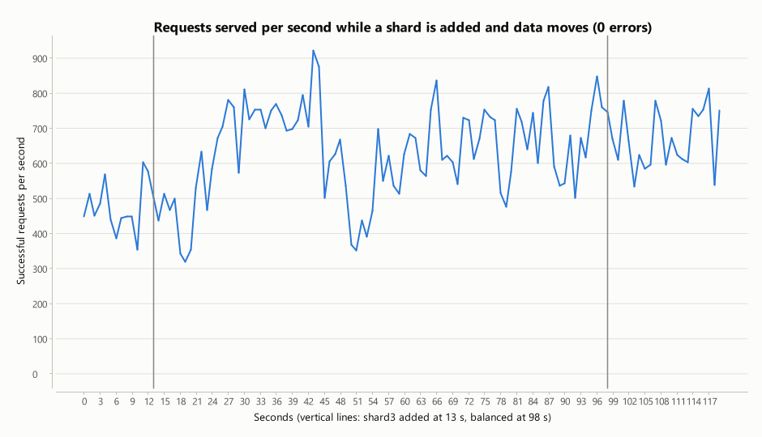

# MongoDB sharding: set-up, tests and results

The main evaluation ([REPORT.md](REPORT.md)) runs the database as a single MongoDB server; only the cache
tier is spread over several servers. This document covers the database tier: the system was run on a real
**MongoDB sharded cluster**, using MongoDB's own sharding. It also describes how the patient data is
split across servers and records what was tested and measured.

All data is synthetic. Everything ran on one laptop (Intel Core Ultra 7 155U, 15.5 GB, on mains power).
Raw numbers are in [results/sharding.json](../results/sharding.json).

## 1. In short

- **The application runs unchanged on a sharded database.** The 16-step workflow check and all 33
  business-rule checks pass through the sharded cluster. That includes twelve simultaneous bookings of one slot,
  of which exactly one succeeds.
- **Data is spread evenly.** With 100,000 patients on two shards, each shard owns 50% ± 0.2% of patients
  and of medical records.
- **A patient's own queries go to one shard; others go to all of them.** MongoDB's query plans show
  single-shard routing when a query includes the patient id, and a query to every shard when it does not.
- **A shard was added while the system was serving patients, with no failed requests.** MongoDB moved 27% of
  patients, 31% of records and 27% of appointments to the new shard in 64 to 85 seconds, while 8 clients kept
  reading patient data; across two runs, 175,019 requests got 0 errors.
- **A shard was stopped abruptly.** Only patients whose data was on that shard lost access. Doctor search,
  emergency requests and every other patient's data kept working, and access returned for everyone once
  the shard was restarted.
- **On one machine, sharding neither helped nor measurably hurt throughput.** All the servers share the
  same processor, so the gain needs separate machines.

## 2. The cluster

| Part | Role | Port |
|---|---|---|
| `mongos` router | The application connects here instead of to a database server. It knows which shard holds which data and forwards each query. | 27100 |
| Config server (replica set `cfg`) | Stores the routing table: which shard owns which range of each collection. | 27101 |
| `shard1`, `shard2` (replica sets) | Each holds part of the data. | 27201, 27202 |
| `shard3` (added during the test) | A third shard, added under load to show data moving onto it. | 27203 |

MongoDB requires every shard and the config server to be a *replica set*. Here each is a one-member replica set
to fit on a laptop. Each server is limited to 256 MB of cache, and data lives in `%LOCALAPPDATA%\hms-sharded`,
outside the OneDrive-synchronised project folder. In production each would have three members (section 7).

## 3. What is sharded, and on which key

The **shard key** decides which shard a document lives on. All keys here are *hashed*: MongoDB hashes
the value and splits the hash range between shards. Consecutive ids therefore spread evenly instead of all
landing on the newest shard.

| Collection | Shard key | Why |
|---|---|---|
| `patients` | hashed `_id` (the patient id) | Patients are the largest group of records and grow without limit |
| `records`, `bills`, `prescriptions` | hashed `patientId` | Everything a patient owns is placed by the same value, so "my records", "my bills" and "my prescriptions" each go to one shard |
| `appointments` | hashed `doctorId` | The rule against double booking is a unique index on (doctor, date, time), and MongoDB can only enforce a unique index on a sharded collection if it starts with the shard key. Placing appointments by doctor keeps all of one doctor's bookings on one shard, so that shard alone can enforce uniqueness |
| `sessions` | hashed `_id` (hash of the session token) | Sessions are looked up by token on every request |
| `users`, `doctors`, `medicines`, `drug_info`, `insurance_plans`, `emergencies`, `ambulances`, `short_urls` | not sharded | Small reference data, or data that must be read as a whole (the emergency queue and the ambulance pool). Unsharded collections live on one shard, the database's *primary shard* |

**Which application queries reach one shard or all of them:**

| Reaches one shard | Reaches every shard (the router asks all of them and merges) |
|---|---|
| a patient's profile, records, bills, prescriptions; a doctor's free slots and schedule; session check on every request | a patient's own appointment list (appointments are placed by doctor, not patient); the pharmacy's queue of prescriptions to dispense (filtered by status) |

Both broadcast queries are cached by the application's key-value cache, so most of them never reach the database.

**Changes to the application.** None were needed to make it work. MongoDB 8 can route an update by `_id`
alone, even when the shard key is something else, and every write to a sharded collection here is an insert
or such an update. One change was made for speed: the bulk loader of synthetic patients
([AdminService.java](../hms-app/src/main/java/com/hms/service/AdminService.java)) now inserts *unordered*.
With an ordered insert the router must start a new round trip whenever the next document belongs to a
different shard. With hashed keys that is almost every document, so loading 20,000 patients took 230.8 s.
Unordered, the router sends one batch per shard, and the same load took 8.0 s, 29 times faster.

## 4. Running it

```
run.bat sharded                      start the cluster (first time: also set it up), then the application on it
run.bat cluster status               which servers run, and documents / MB / ranges per shard
run.bat cluster add-shard shard3 27203   add a shard and wait for the balancer to move data onto it
run.bat cluster kill shard2          stop one shard abruptly (failure test)
run.bat cluster revive shard2 27202  start it again
run.bat cluster stop                 stop the cluster, keep its data
run.bat cluster reset                stop it and delete its data
```

`run.bat cluster` runs [scripts/sharded-cluster.ps1](../scripts/sharded-cluster.ps1), which starts the MongoDB
processes. The set-up and the measurements are done by `java -jar hms-bench/target/hms-bench.jar shard ...`
([ShardingTool.java](../hms-bench/src/main/java/com/hms/bench/ShardingTool.java)):

| Command | What it does |
|---|---|
| `shard setup` | registers the shards, shards the collections, creates the double-booking index (run by `cluster start` the first time) |
| `shard status [label]` | documents, MB and ranges each shard *owns* (MongoDB's `$shardedDataDistribution`) |
| `shard explain` | which shards four example queries are sent to |
| `shard sample N` | picks N synthetic patients and notes which shard holds each one's data |
| `shard load URL SECONDS THREADS label` | steady read load through the application: sign in as the sampled patients, open profiles and records |
| `shard failure-check URL SHARD label` | with a shard stopped: sign in each sampled patient, read their data, try the unsharded functions |
| `shard charts` | draws the two graphs below |

The application needs MongoDB 7.1 or newer for sharding (tested with 8.2.3).

## 5. Results

### 5.1 The application works the same

On the sharded cluster, with the application connected to the router:

| Check | Result |
|---|---|
| Workflow demonstration (`run.bat demo`) | all steps passed (16, plus the crawler step when a crawl has run): registration, sign-in, search, booking, double booking refused, records, prescription and dispensing, billing, payment, short link, emergency, rate limiter |
| Business-rule checks ([scripts/business-rules-check.mjs](../scripts/business-rules-check.mjs)) | 33 of 33 passed, on two shards and again on three |
| 12 simultaneous bookings of one slot | 1 succeeded, 11 refused: the unique index is enforced on the sharded collection |

### 5.2 Data is spread evenly

100,000 synthetic patients, each with a sign-in, two medical records and one past appointment:

| Collection | shard1 | shard2 |
|---|---|---|
| patients | 49,912 (49.9%) | 50,089 (50.1%) |
| records | 99,822 (49.9%) | 100,178 (50.1%) |
| appointments | 54,727 (54.7%) | 45,273 (45.3%) |

Appointments are less even because they are placed by doctor, and the loader assigns them to only 200
doctors. With so few distinct keys, chance makes one shard's share larger.

### 5.3 Queries go only where the data is

MongoDB's query plan, read through the router:

| Query | Router's plan | Shards asked |
|---|---|---|
| records of one patient (filter includes the shard key) | `SINGLE_SHARD` | shard2 |
| one patient by id (filter includes the shard key) | `SINGLE_SHARD` | shard2 |
| all diagnoses (no shard key in the filter) | `SHARD_MERGE` | shard1, shard2 |
| bills over Rs 1,000 (no shard key in the filter) | `SHARD_MERGE` | shard1, shard2 |

This is why the shard keys follow the most common question: "this patient's data".

### 5.4 Adding a shard while the system is in use

Eight clients continuously opened sampled patients' profiles and records through the application, with the
cache switched off so that every request reached the database. During this, a third shard was started and
added. MongoDB's balancer then moved ranges of data onto it with no further action.


| | Patients | Records | Appointments |
|---|---|---|---|
| Before: shard1 / shard2 | 49,912 / 50,089 | 99,822 / 100,178 | 54,727 / 45,273 |
| After: shard1 / shard2 / shard3 | 36,358 / 36,535 / 27,108 | 68,484 / 68,840 / 62,676 | 36,514 / 36,277 / 27,209 |
| Moved to shard3 | 27% | 31% | 27% |



| Run | Requests | Errors | Time to balance | Requests per second: before / during / after | p95 |
|---|---|---|---|---|---|
| A | 100,399 | 0 | 64 s | 1,032 / 1,012 / 492 | 24.6 ms |
| B (graph above) | 74,620 | 0 | 85 s | 475 / 631 / 672 | 27.3 ms |

- **No request failed in either run.** While a range moves, the old shard keeps answering for it. When the
  copy is complete, the routing table is switched in one step, and the router sends later queries to the
  new shard.
- **Throughput did not fall while data moved** in run B. In run A it fell in the second half, but it stayed low
  after balancing had finished, while other software on the laptop was busy. Run B and a control run with no
  changes at all both showed similar swings, so on this shared machine the dip cannot be attributed to the
  migration.
- **"Balanced" does not mean exactly equal.** MongoDB 8 moves data only while two shards differ by more
  than three range sizes. The range size was set to 1 MB (the default is 128 MB) so that a laptop-sized data set
  would move at all, which leaves the shards at about 36% / 37% / 27%.
- **The old copies are deleted later.** A shard that hands over a range keeps its copy for 15 minutes by
  default, in case a query that started before the switch still needs it. `shard status` lists these
  separately as "moved, not yet deleted"; queries through the router never return them.

### 5.5 A shard fails

With three shards, shard2 was stopped abruptly. Then 200 randomly chosen patients each tried to sign in
(up to five attempts, as a person would) and open their profile and records. The cache was switched off
so that the database tier was tested on its own.

| Patients | Signed in (first try / after retrying) | Profile opened | Records opened | Slowest read |
|---|---|---|---|---|
| 123 with all their data on shard1 or shard3 | 58 / 62 (3 gave up) | 120 of 120 | 120 of 120 | 108 ms |
| 77 with their profile on shard2 | 39 / 36 (2 gave up) | 0 of 75 | 6 of 75 (the 6 whose records are on shard3) | 15.5 s, then an error |

| Function whose data is not sharded | Result |
|---|---|
| Doctor search | worked (200) |
| Emergency request without signing in | worked (201); the ambulance was dispatched |

After shard2 was restarted, all 200 patients signed in at the first attempt and opened their profile and
records.

What this shows:

- **A failure is contained to the data on that shard.** About a third of patients could not open their
  data; the other two thirds, the doctor directory, the emergency service and the ambulance pool were not
  affected. On a single database server, the same failure stops everything.
- **Sign-in was affected for everyone, at random.** Each sign-in stores a new session, placed by a hash of
  its random token. The session collection is small, so the balancer had not given shard3 any of it, and
  half of new sessions belonged to the stopped shard. Retrying works because the next token hashes
  elsewhere.
- **Failing requests are slow, not quick.** The router waits up to 15 seconds for the missing shard before
  giving up, so the requests that fail take 15 seconds to do so.

### 5.6 Speed on one machine

The same 30-second read load (8 clients, cache off, 100,000 patients), run one after another under the same
conditions:

| Database | Requests per second | Average | p95 | Errors |
|---|---|---|---|---|
| One MongoDB server, not sharded (two runs) | 1,144 and 1,284 | 6.9 and 6.2 ms | 16.1 and 14.0 ms | 0 |
| Sharded, 2 shards | 1,599 | 5.0 ms | 8.4 ms | 0 |
| Sharded, 3 shards | 1,256 | 6.3 ms | 12.6 ms | 0 |

The differences are within the run-to-run variation on this laptop. Later, while other software was busy,
the same two-shard measurement gave 596 req/s. The detour through the router costs no measurable time
at this load. Adding shards also adds no capacity here, because every shard shares the same processor,
memory and disk. Sharding pays off when each shard has its own machine. Then each shard handles only its
share of the data and of the queries that include the shard key, so capacity grows with the number of shards.

## 6. How this relates to the cache's consistent hashing

The project now spreads data in two places, for different reasons:

| | Key-value cache (component 6 and 7) | MongoDB sharding |
|---|---|---|
| What is spread | cached copies, rebuilt from the database if lost | the data itself |
| How keys are placed | consistent hash ring, 150 virtual nodes per server | hash ranges, a routing table on the config server |
| When a server is added | about 1/N of keys change server, immediately, no copying (a missed key is reloaded) | the balancer copies ranges in the background, then switches ownership |
| When a server is lost | requests fall through to the database; nothing is lost | data on that shard is unavailable until it returns (or, with replica sets, until a copy takes over) |

Both use a hash of the key, so consecutive ids do not pile up on one server, and both move only part of
the data when a server is added.

## 7. Limits of this test, and what production would change

- **Each shard is one server.** A stopped shard means its data is unavailable, which is the worst case tested
  above. In production each shard is a replica set of three servers: if one stops, another is elected in a
  few seconds and nothing becomes unavailable. The config server is also a three-member replica set, and there
  is usually one router per application server.
- **Sessions should not depend on a single shard.** Either keep shard replica sets (above) or store sessions
  where losing one server does not sign people out, for example only in the replicated key-value cache.
- **Fail faster.** An operation timeout in the application's MongoDB client (the driver's `timeoutMS`) would
  turn the 15-second wait into a quick error, so the application could answer "temporarily unavailable"
  at once.
- **One machine.** All servers shared one laptop, which other software was also using during the runs.
  Section 5.6 is a check that sharding costs nothing, not a measurement of what it gains.
- **Range size of 1 MB** was set only so that a small data set would move. The default of 128 MB is right
  for real data volumes.
