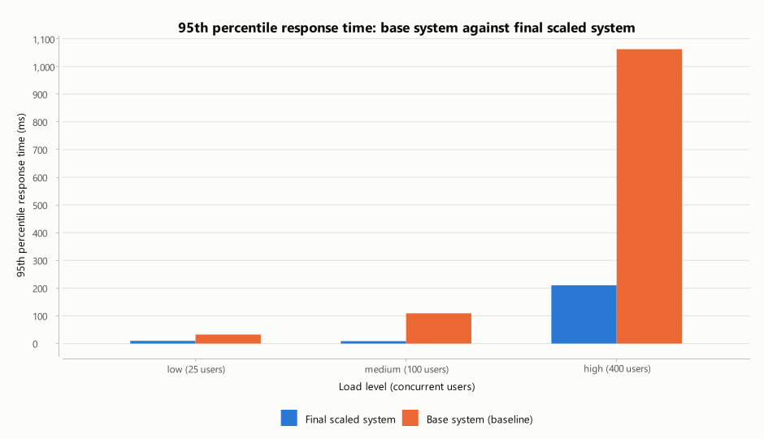

# Scalable Hospital Management System — Summary Report

| | |
|---|---|
| **What** | A working prototype of a hospital management system built around seven system-design components |
| **Stack** | Java 17 · Spring Boot 4.1 · MongoDB 8 · a single-page web portal (no frameworks) |
| **Data** | Synthetic only: no real patient, doctor, medicine or insurer information is used anywhere |
| **Detail** | [REPORT.md](REPORT.md) (full report) · [TEST_REPORT.md](TEST_REPORT.md) (base against final scaled system) · [SHARDING.md](SHARDING.md) (MongoDB sharded cluster) · [RESULTS.md](RESULTS.md) (every measurement) · [COMPONENT_USAGE.md](COMPONENT_USAGE.md) (where each component is in the code) |

---

## 1. In one paragraph

The system lets patients register, find a doctor, book and cancel appointments, read their medical records and
prescriptions, pay bills with insurance cover and share them by short link, and request an ambulance without an
account. Doctors see their schedule, add records and prescribe; the pharmacy dispenses; administrators watch and
control the infrastructure. All seven required system-design components were implemented from scratch and each
one is used for a real hospital function. Measured on one laptop, the system served **about 1,800 requests per
second with a 95th-percentile response time of 76 ms and no errors**, stayed flat as patients grew from 1,000
to 100,000, and **lost no requests when a cache server was killed** under load.

## 2. Architecture


- **MongoDB is the system of record.** Indexes keep every lookup fast as data grows, and conditional updates and
  a unique index make double booking, double payment and double dispensing impossible without locks.
- **A distributed key-value cache sits in front of it**, spread over several cache servers by consistent hashing,
  with each key stored on two servers. Losing a cache server costs speed, never data.
- **Every request first passes the rate limiter**, which gives each client a separate allowance per kind of
  request; emergencies have their own allowance.
- **Application servers hold no session state**, so more can be added behind a load balancer.

## 3. The seven components: where and why

| Component | Used for | Why this component | Result |
|---|---|---|---|
| **Rate limiter** (token bucket) | Every request; strict limits on login, separate allowance for emergencies | Stops one client degrading service for everyone, slows password guessing | Refused 99.8% of a flooding client's requests; never refused a normal user |
| **Unique ID generator** (Snowflake) | Every patient, appointment, record, prescription, bill and emergency id | Unique across servers without a shared counter; ids sort by time | 3.9 million ids/s per server, 0 collisions in 6 million |
| **Autocomplete** (trie, top-k cached) | Doctor, specialization and medicine search; tolerates one typo | Answers each keystroke without touching the database | ~1 µs per lookup at 100,000 entries, 5,967× faster than scanning |
| **URL shortener** | Sharing a bill by short link | Short, expiring, unguessable links; only internal targets allowed | 1.0 ms redirect, 0 collisions with 8-character codes |
| **Web crawler** | Drug reference information and insurance plans from (simulated) external sites | External data that changes elsewhere; feeds billing and pharmacy | 592 pages/s with 32 workers; obeys robots.txt; skips duplicates |
| **Consistent hashing** | Choosing the cache server for each key | Adding or losing a server moves only its share of keys | 22% of keys moved on 4→5 servers, against 80% for `hash mod N` |
| **Key-value store** | Sessions, profiles, records, appointments, slots, bills, links | Repeated reads served from memory instead of the database | Lookups 3–6× faster than MongoDB; flat from 10,000 to 1,000,000 keys |

## 4. The prototype


 

Without an account only two things are possible: signing in (or creating an account) and requesting an
ambulance. After signing in, the portal adapts to who you are: patients see their overview, appointments, records and bills;
doctors their schedule and patient records; the pharmacy its counter; administrators a live **System** page
that shows all seven components working, lets them stop or add a cache server, and charts requests per second
and the cache hit ratio as it happens. It uses a white-and-orange theme, offers a dark mode, and works on a phone.

Every workflow is verified automatically: 22 unit tests on the components, a 16-step end-to-end workflow check
(`run.bat demo`), 33 business-rule checks (including twelve simultaneous bookings of one slot, of which exactly
one succeeds), and a 49-check browser test covering every role.

## 5. Key results

All figures were measured on one laptop (Intel Core Ultra 7 155U, 15.5 GB, running on battery) with the load
generator, application, cache and database sharing it, so they are conservative.

**Load levels** (each user acts like a patient and pauses 0.1–0.3 s between actions):

| Level | Users | Throughput | Average | 95th percentile | Errors |
|---|---|---|---|---|---|
| Low | 25 | 123 req/s | 6.1 ms | 8.6 ms | 0% |
| Medium | 100 | 495 req/s | 5.0 ms | 6.5 ms | 0% |
| High | 400 | 1,832 req/s | 16 ms | 76 ms | 0% |
| Stress | 1,000 | 2,042 req/s | 266 ms | 700 ms | 0% |


**Against a simple baseline:**

| Comparison | Proposed design | Baseline |
|---|---|---|
| Reading patient records (100 users) | 1.7 ms with the cache | 3.2 ms from MongoDB only |
| Doctor search, 25,200 doctors | 1.3 ms with the autocomplete index | 238 ms with a database query |
| Ordinary users' p95 while one client floods the API | 97 ms with the rate limiter | 217 ms without |
| Cache still usable after one of 4 servers fails | 77% (100% with two copies) | 25% with `hash mod N` |


**Base system against the final scaled system** (same workload, same data: 20,000 patients and 5,200 doctors;
measured separately, on battery; full report in [TEST_REPORT.md](TEST_REPORT.md)):

| Load | Base system: p95 · throughput | Final scaled system: p95 · throughput |
|---|---|---|
| 25 users | 32.5 ms · 114 req/s | 9.6 ms · 118 req/s |
| 100 users | 109 ms · 428 req/s | 8.5 ms · 476 req/s |
| 400 users | 1,062 ms · 469 req/s | 210 ms · 1,220 req/s |

The base system has the scaling components switched off: no cache, a database query for every search and
suggestion, no rate limiter. It saturates at about 470 requests a second; the scaled system serves 2.6 times that
with a 5-times-lower 95th percentile, and neither returned an error.



**Scalability and failure:**

- Growing from **1,000 to 100,000 patients** left record access unchanged (p95 5.5 → 6.3 ms from MongoDB,
  1.6 ms with the cache).
- Killing a cache server, restarting it and adding a new one under 1,000 requests a second caused **zero
  errors**. With one copy of each key the cache hit ratio dipped from 90% to 78% and recovered in about three
  seconds; with two copies the failure was invisible.


**The database sharded** ([SHARDING.md](SHARDING.md)). The same application was also run on a real MongoDB
sharded cluster (a router, a config server and two shards), with patient data placed by a hash of the
patient id:

- All workflow and business-rule checks pass unchanged; the double-booking rule still holds across shards.
- 100,000 patients split 49.9% / 50.1%; a patient's own queries go to one shard only.
- A third shard was added under load: 27% of patients moved onto it in about a minute, with **0 errors in
  175,019 requests**.
- With one shard stopped, only the patients whose data was on it lost access; doctor search and emergencies
  kept working.
- On one laptop sharding neither raised nor measurably lowered throughput, since all shards share one
  processor. The gain needs separate machines.


## 6. Conclusions

- **Each component did the job it was chosen for**, and each was measured against a simpler alternative.
  The largest gains are the search index (two orders of magnitude) and consistent hashing (a server failure
  costs a quarter of the cache instead of three quarters).
- **The system fails gracefully.** Past its capacity it slows down rather than returning errors; a lost cache
  server costs speed, not correctness.
- **The first bottleneck is password hashing.** Logins and registrations are 2% of requests but use about
  two-thirds of the CPU at the high load level, by design (BCrypt is deliberately slow). A dedicated thread pool
  would stop it starving other requests.
- **Limits of this evaluation:** everything ran on one throttled laptop; the next step is separate machines and
  several application servers behind a load balancer. Rate limits count requests rather than cost, and the
  autocomplete index lives in each server's memory; both are discussed in REPORT.md, section 6.

## 7. Deliverables

| Brief | Where |
|---|---|
| 1. Requirement analysis and component mapping | REPORT.md sections 1–2; COMPONENT_USAGE.md |
| 2. System architecture and design | REPORT.md section 3; diagram above |
| 3. Working prototype | the code (`hms-components`, `hms-app`); REPORT.md section 4; this section 4 |
| 4. Performance evaluation | REPORT.md section 5; RESULTS.md (all tables and 18 graphs); SHARDING.md (sharded database); raw data in `results/` |

## 8. Running it

```
run.bat              start the application, then open http://localhost:8088
run.bat demo         walk through every workflow (with the application running)
run.bat bench all    repeat every measurement and regenerate the graphs (about 20 minutes)
run.bat sharded      start a local MongoDB sharded cluster and the application on it
```

Requires JDK 17+, Maven and MongoDB on `localhost:27017`. Demo logins (synthetic) are shown on the sign-in page.
