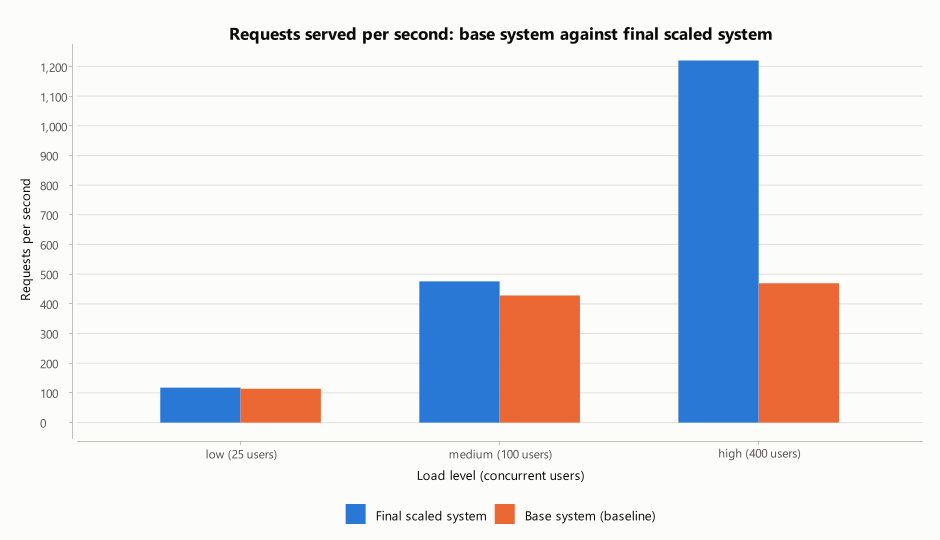
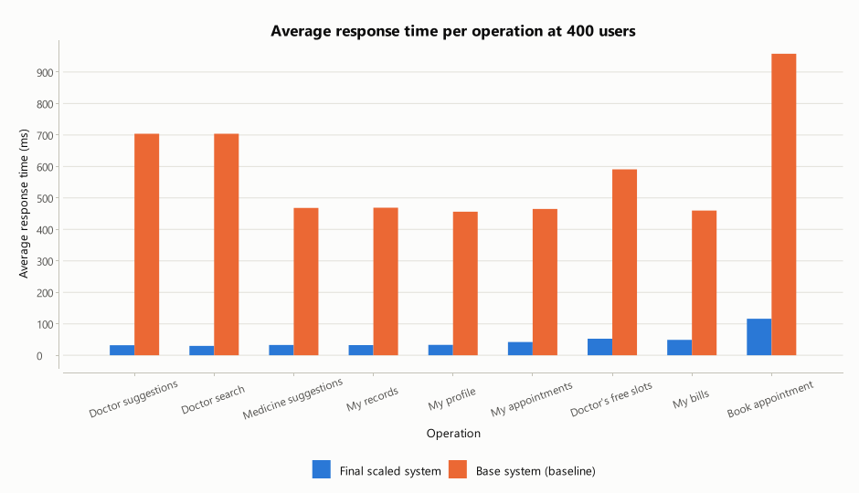

# Base system and final scaled system: load test report

This report is generated by `hms-bench report` from `results/compare.json`, which `hms-bench compare`
produces. To repeat it: `run.bat bench compare`, then `run.bat bench report`.

**Measured** 2026-10-25T14:39:50+05:30 on Windows 11 10.0, 14 logical cores, 15.5 GB RAM, running on battery. Load generator, application, cache nodes and MongoDB all ran on this one machine.

## 1. What was compared

Both runs use the same application, the same database contents, the same simulated users and the same
workload. Only the scaling components differ. They are switched off at run time for the base system,
so the comparison isolates their effect rather than comparing two different programs.

|  | Base system | Final scaled system |
| --- | --- | --- |
| Checking the session on every request | MongoDB query | Key-value cache (3 servers, consistent hashing, 2 copies of each key) |
| Reading a patient's profile, records, appointments, bills; a doctor's free slots | MongoDB query | Key-value cache; MongoDB only on a miss |
| Doctor and medicine search, and suggestions while typing | MongoDB pattern query on every keystroke | In-memory autocomplete index (trie) |
| Rate limiter | Off | On (token bucket per client and request type) |
| Writes, ids, indexes, booking rules, crawled data | Same | Same |

## 2. Test setup

- **Data:** 20,001 patients, 40,000 medical records and 5,200 doctors in MongoDB.
- **Load levels:** [25, 100, 400] concurrent users. Each user is a logged-in patient who performs an action, pauses 100-300 ms, and repeats.
- **Workload:** 85% reads and searches, 15% writes (bookings, payments, link sharing, emergencies, logins,
  registrations), the same mix as in [RESULTS.md](RESULTS.md) section 1.
- **Timing:** both configurations were exercised unmeasured first; then each level ran for 6 s of warm-up and 25 s of measurement.
- **Counting:** a booking refused because the slot was taken (HTTP 409) is a correct answer and counts as a success;
  timeouts, server errors and dropped connections count as errors.

## 3. Results

| Load | System | Throughput (req/s) | Avg (ms) | Median (ms) | p95 (ms) | p99 (ms) | Errors | App CPU (cores) |
| --- | --- | --- | --- | --- | --- | --- | --- | --- |
| Low (25 users) | Base | 114 | 14.6 | 6.06 | 32.5 | 148 | 0.00% | 0.97 |
|  | **Scaled** | 118 | 6.97 | 2.94 | 9.62 | 146 | 0.00% | 0.97 |
| Medium (100 users) | Base | 428 | 27.4 | 9.61 | 109 | 235 | 0.00% | 2.39 |
|  | **Scaled** | 476 | 6.28 | 2.56 | 8.50 | 151 | 0.00% | 2.16 |
| High (400 users) | Base | 469 | 619 | 555 | 1,062 | 2,182 | 0.00% | 2.09 |
|  | **Scaled** | 1,220 | 90.5 | 28.4 | 210 | 2,700 | 0.00% | 4.58 |

**Scaled compared with base:**

| Load | Average | Median | 95th percentile | Throughput |
| --- | --- | --- | --- | --- |
| Low (25 users) | **2.1× faster** | **2.1× faster** | **3.4× faster** | 114 → 118 req/s |
| Medium (100 users) | **4.4× faster** | **3.7× faster** | **13× faster** | 428 → 476 req/s |
| High (400 users) | **6.8× faster** | **20× faster** | **5.0× faster** | 469 → 1,220 req/s |

### Operation by operation at the highest load (400 users)

| Operation | Base avg (ms) | Base p95 (ms) | Scaled avg (ms) | Scaled p95 (ms) | Scaled is |
| --- | --- | --- | --- | --- | --- |
| Doctor suggestions | 704 | 1,025 | 32.0 | 98.2 | **22× faster** |
| Doctor search | 704 | 1,041 | 29.7 | 93.3 | **24× faster** |
| Medicine suggestions | 468 | 695 | 32.7 | 104 | **14× faster** |
| My records | 469 | 696 | 32.3 | 98.8 | **15× faster** |
| My profile | 456 | 676 | 33.0 | 100 | **14× faster** |
| My appointments | 465 | 698 | 42.2 | 135 | **11× faster** |
| Doctor's free slots | 591 | 879 | 52.6 | 146 | **11× faster** |
| My bills | 460 | 676 | 49.2 | 143 | **9.4× faster** |
| Book appointment | 958 | 1,320 | 116 | 318 | **8.2× faster** |
| Pay bill | 572 | 824 | 87.2 | 245 | **6.6× faster** |
| Emergency request | 875 | 1,189 | 186 | 498 | **4.7× faster** |
| Login | 2,181 | 3,010 | 2,192 | 3,408 | about the same |

### Resources used by the application

| Load | CPU base (cores) | CPU scaled (cores) | Heap base (MB) | Heap scaled (MB) | Threads base | Threads scaled | Cache hit ratio (scaled) |
| --- | --- | --- | --- | --- | --- | --- | --- |
| Low (25 users) | 0.97 | 0.97 | 127 | 130 | 109 | 241 | 87.70% |
| Medium (100 users) | 2.39 | 2.16 | 131 | 132 | 102 | 244 | 89.10% |
| High (400 users) | 2.09 | 4.58 | 120 | 133 | 241 | 269 | 89.60% |

CPU and heap are the application process only. MongoDB and the load generator ran on the same machine and are
not included; in the base system much of the extra work happens inside MongoDB.

## 4. Findings

- **Low (25 users):** the 95th-percentile response time went from 32.5 ms to 9.62 ms (3.4× faster), and throughput from 114 to 118 requests per second. Neither system returned an error.
- **Medium (100 users):** the 95th-percentile response time went from 109 ms to 8.50 ms (13× faster), and throughput from 428 to 476 requests per second. Neither system returned an error.
- **High (400 users):** the 95th-percentile response time went from 1,062 ms to 210 ms (5.0× faster), and throughput from 469 to 1,220 requests per second. Neither system returned an error.
- **The slowest 1% of requests are logins in both systems.** A login computes a deliberately slow BCrypt password
  hash, which neither configuration changes: at the highest load a login averaged 2,181 ms in the base system and 2,192 ms in the scaled one, which was
  also processing 2.6 times as many requests. That is why the 99th percentile barely differs, or is higher for the scaled system, while
  the median and the 95th percentile improve.

Throughput is set mostly by how many users there are and how long they pause, so the two systems serve similar
request rates until one of them runs out of capacity; the difference shows first in response times. Where the
base system's throughput falls below the scaled system's, it has reached its limit: its users spend their time
waiting for answers instead of making new requests. The causes of the difference, component by component,
are measured separately in [RESULTS.md](RESULTS.md) sections 3 and 5.
